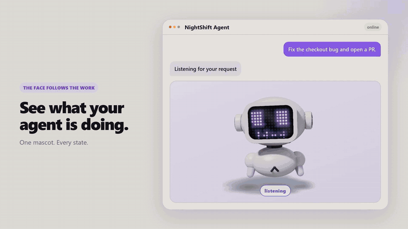
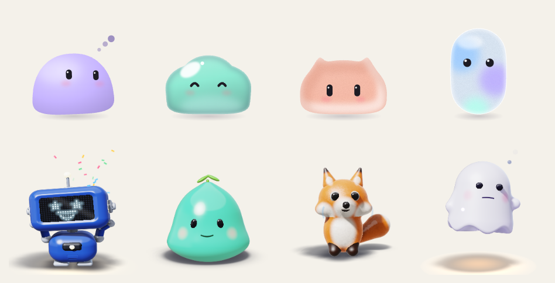
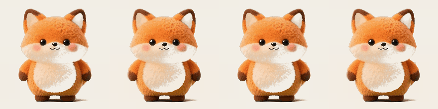
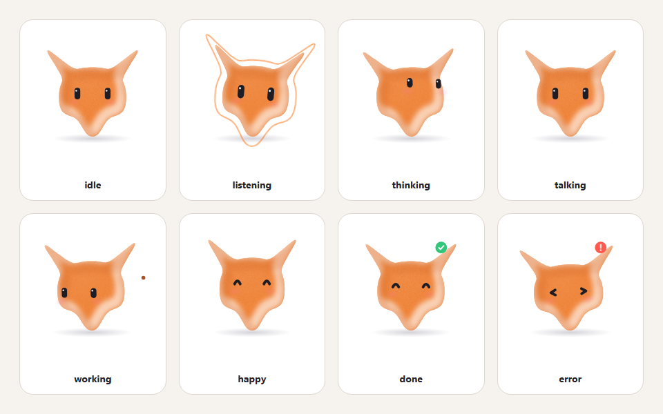
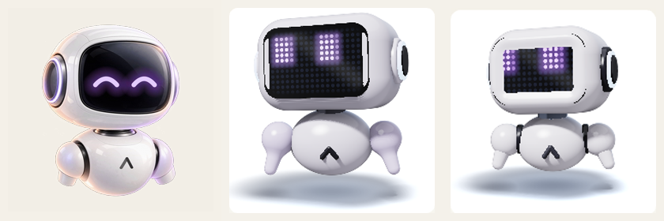

<div align="center">

# MascotForge

**Tes utilisateurs ne savent pas si ton agent IA réfléchit ou s'il est planté. Donne-lui un visage.**

Crée une mascotte d'état animée avec les états repos, écoute, réflexion, parole, réussite et erreur. Exporte un seul Web Component et change son état avec un appel `play()`.

[**Créer une mascotte**](https://arivex-ca.github.io/mascotforge/) · [Installer en local](#installer-en-local) · [L'utiliser avec un agent IA](#pour-les-agents-ia) · [English](README.md)

<a href="https://arivex-ca.github.io/mascotforge/">
  
</a>

</div>

## Choisis ton parcours

Chaque parcours exporte le même composant `<mascot-avatar>` et la même API `play(state)`.

| Parcours | Idéal pour | Coût | Nécessaire |
|---|---|---:|---|
| **Blob** | Un visage d'état adapté à ta marque | Gratuit | Un navigateur |
| **Personnage 3D** | Un personnage prêt à utiliser avec dix humeurs animées | Gratuit | Un navigateur |
| **Vidéo IA** | Une mascotte créée depuis ton image ou ton prompt | Environ 1 $ pour quatre états | Ta clé fal.ai |

Les mascottes blob et 3D s'animent dans le navigateur, suivent le curseur et n'appellent aucun service tiers. La vidéo IA utilise Kling pour animer le personnage dans les états choisis.

## Ajoute-la à ton agent

Copie le dossier exporté dans ton site, puis ajoute trois lignes :

```html
<mascot-avatar manifest="./mascot/manifest.json" label="Mon assistant"></mascot-avatar>
<script src="./mascot/mascot.js"></script>
<script>document.querySelector("mascot-avatar").play("thinking");</script>
```

Ton interface peut maintenant montrer ce que fait l'agent :

```js
const mascot = document.querySelector("mascot-avatar");

mascot.play("listening");
mascot.play("thinking");
mascot.play("talking");
mascot.play("done");
mascot.play("error");
```

Les noms d'état courants fonctionnent avec les parcours Blob, 3D et vidéo. Le widget prend aussi en charge le sommeil, les réactions au clic, le suivi du curseur, les mouvements réduits et les changements immédiats ou en fin de boucle.

## Utilise-la pour

- **Assistants de chat :** remplace une roue de chargement par les états écoute, réflexion et parole.
- **Agents de code :** montre le travail actif, la réussite et les erreurs sans exposer les journaux internes.
- **Tâches en arrière-plan :** rassure l'utilisateur pendant un traitement long.
- **Agents vocaux :** donne un visage réactif à la conversation sans synchronisation des lèvres.

## Installer en local

### Prérequis

- Python 3.10 ou plus
- ffmpeg et ffprobe pour les vidéos IA transparentes
- Une clé fal.ai uniquement pour la vidéo IA

Les mascottes blob et 3D intégrées ne demandent aucune clé fournisseur.

```bash
git clone https://github.com/Arivex-ca/mascotforge.git
cd mascotforge
python -m venv .venv
.venv/bin/pip install -r requirements.txt   # Windows : .venv\Scripts\pip
cp .env.example .env                        # facultatif : ajoute FAL_KEY
.venv/bin/python -m uvicorn backend.main:app --port 8766 --env-file .env
```

Ouvre :

- Studio : `http://localhost:8766/`
- Démo du widget : `http://localhost:8766/widget/`

Sans ffmpeg, la génération fonctionne et conserve le fond vert. `GET /api/health` indique si ffmpeg et la clé de repli du serveur sont disponibles.

## Ce que MascotForge produit

MascotForge a produit chaque exemple ci-dessous.

<table>
  <tr>
    <td width="50%">
      
      <p><b>Mascottes gratuites en code</b><br>Les styles Blob et 3D s'animent dans le navigateur et suivent le curseur.</p>
    </td>
    <td width="50%">
      
      <p><b>États en vidéo IA</b><br>Ce renard a coûté 1,01 $ pour les états repos, réflexion, parole et erreur.</p>
    </td>
  </tr>
  <tr>
    <td width="50%">
      
      <p><b>Dessiné par un agent</b><br>Codex a créé ce renard par MCP, a reconnu un chat dans son premier aperçu, puis a corrigé la forme.</p>
    </td>
    <td width="50%">
      
      <p><b>Image vers 3D</b><br>Un modèle de vision écrit et vérifie un personnage Wobnimo depuis ton image de référence.</p>
    </td>
  </tr>
</table>

Consulte la [galerie visuelle complète](docs/gallery.fr.md) pour le suivi du curseur, les écrans du studio, les formes Blob personnalisées et les humeurs 3D.

## Fonctionnement

1. **Choisis un personnage :** pars d'un blob, d'un personnage 3D intégré, d'une image ou d'un prompt.
2. **Choisis les états :** utilise un modèle ou définis jusqu'à 12 états avec tes mots.
3. **Prévisualise et corrige :** inspecte chaque état avant l'export. Un agent peut répéter cette boucle visuelle par MCP.
4. **Livre un composant :** télécharge le dossier, ajoute `<mascot-avatar>` et appelle `play(state)` depuis ton application.

Le parcours vidéo IA ajoute la génération Kling et le détourage ffmpeg. Les parcours gratuits rendent la mascotte en code.

## Pour les agents IA

MascotForge fournit un CLI, un serveur MCP et un skill Agent Skills. Un agent peut concevoir une mascotte, inspecter l'aperçu, la corriger et exporter le résultat sans ouvrir le studio.

```bash
python -m mascotforge styles
python -m mascotforge code --engine blob --set shape=cloud --out ./mon-blob
python -m mascotforge code --engine 3d --set character=volt --out ./mon-robot
python -m mascotforge mcp
python -m mascotforge skill
```

Les outils Blob et Wobnimo gratuits ne demandent aucune clé fournisseur. Les outils payants de vidéo et d'image vers 3D affichent une estimation et s'arrêtent jusqu'à l'approbation du coût.

Lis la [référence des agents et du CLI](docs/technical-reference.fr.md#agents-cli-et-mcp) pour Claude Desktop, Cursor, Codex, la sortie JSON, les fiches Blob personnalisées et la correction visuelle Wobnimo.

## Tu veux que je crée la première avec toi ?

Les 10 premières mascottes sont offertes. [Dis-moi ce que fait ton agent](https://github.com/Arivex-ca/mascotforge/issues/new?title=Demande%20de%20mascotte%20%3A%20&body=Que%20fait%20ton%20agent%20%3F%0A%0AStyle%20%28blob%2C%203D%20ou%20vid%C3%A9o%29%20%3A%0A%0AComment%20as-tu%20trouv%C3%A9%20MascotForge%20%3F%0A) et je construis la tienne à la main, gratuitement.

En échange, je pose trois questions : l'installerais-tu, quels états manquent et sur quoi tourne ton agent ?

Cette limite correspond à ma capacité réelle. Le studio autonome, le CLI, le serveur MCP et le code source restent accessibles à tous.

## Coût et confidentialité

| Opération | Coût habituel |
|---|---:|
| Mascotte Blob ou 3D intégrée | Gratuit |
| État vidéo IA de 3 secondes | Environ 0,25 $ |
| Mascotte vidéo IA de quatre états | Environ 1 $ |
| Interprétation 3D depuis une image | Environ 0,15 à 0,60 $ |

Tu fournis la clé du fournisseur. Le navigateur l'envoie dans un en-tête dédié uniquement lorsqu'une opération l'exige. MascotForge ne place aucune clé dans les URL, les tâches, les journaux, les exports ou les réponses API.

Ne configure pas une clé de repli partagée sur une instance publique. Les visiteurs sans clé personnelle dépenseraient depuis ce compte.

Lis la [référence technique](docs/technical-reference.fr.md) pour les modèles fournisseurs, les coûts exacts, la sécurité, les routes API, le format d'export, les attributs du widget et le suivi du curseur.

## Tester

```bash
.venv/bin/python -m pytest tests/ -v
```

Les appels fournisseurs sont simulés. Le test alpha exécute le vrai ffmpeg sur un clip synthétique. Les tests navigateur s'exécutent lorsque Playwright est installé.

## Documentation

- [Référence technique](docs/technical-reference.fr.md)
- [Galerie visuelle](docs/gallery.fr.md)
- [Contribuer](CONTRIBUTING.md)
- [Provenance et licences des moteurs](engines/README.md)
- [Skill Agent MascotForge](skills/mascotforge/SKILL.md)
- [README anglais](README.md)

Le studio, l'aide du CLI et les erreurs de l'API sont en français pour le moment. Les issues et les Pull Requests en anglais sont les bienvenues.

## Licence

MascotForge utilise la licence MIT. Consulte [LICENSE](LICENSE).

Blob Atelier de Victoria Wu et Wobnimo de Pourya Akhbari conservent leurs licences MIT. Leurs fichiers de licence accompagnent les moteurs dans chaque export concerné.

Créé par [Arivex](https://arivex.ca), qui construit des agents IA pour les entreprises.

