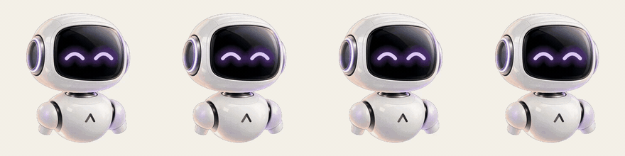
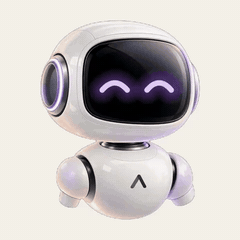
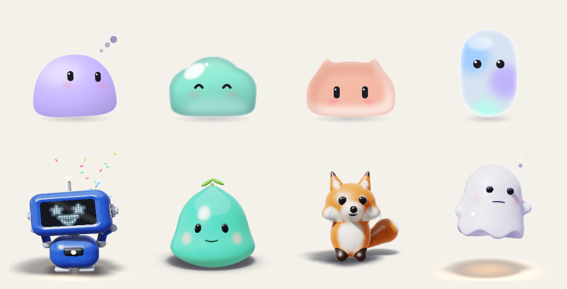
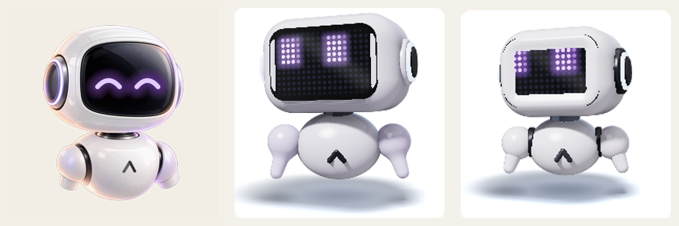
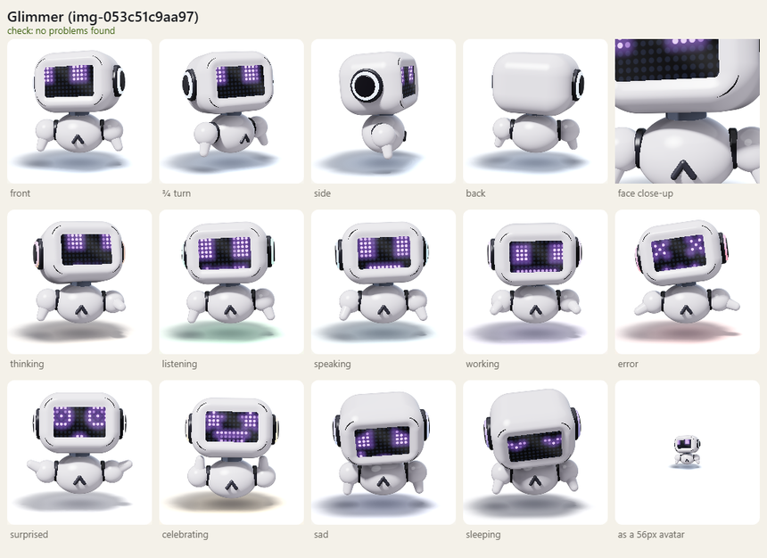

# MascotForge (text-to-mascot)

Brique produit Arivex : tu décris une mascotte (ou tu envoies son image), tu
choisis ses états d'animation, et l'outil sort une mascotte animée à fond
transparent, prête à coller dans un site ou devant un agent IA.

Trois styles, un seul widget `<mascot-avatar>` et une seule API `play(etat)` :

- **Vidéo IA** : ton personnage animé par Kling, états à la demande (pipeline ci-dessous).
- **Blob en code** : Blob Atelier (Victoria Wu, MIT), gratuit et instantané.
- **3D en code** : Wobnimo (Pourya Akhbari, MIT), 20 personnages, gratuit et instantané.

## Galerie

Tout ce qui suit a été produit par MascotForge.

**Vidéo IA** : le robot Arivex, à partir d'une seule image, en 4 états (repos,
réflexion, parole, panne). Fond transparent, boucles sans saut ; ici posé sur
un fond crème. Coût : 1,01 $ pour les 4 états.



**Suivi du curseur** : un clip de 8 s où seule la tête regarde dans les 4
directions ; au repos, le widget affiche l'image qui regarde vers la souris.



**Mascottes en code** : 4 blobs de Blob Atelier et 4 personnages de Wobnimo,
réglés dans le studio, chacun dans un état différent. Gratuits, animés en
direct dans le navigateur, ils suivent le curseur.



**Personnage 3D depuis une image** : à gauche l'image d'origine, puis deux
personnages Wobnimo écrits par un modèle d'après cette image (Visor, puis
Glimmer avec la comparaison visuelle). C'est une interprétation dans le style
Wobnimo, pas une copie : environ 0,13 à 0,40 $ par personnage.



Le même personnage dans ses 10 humeurs, sous 4 angles :



Pipeline :

1. Personnage : image envoyée (PNG détouré conseillé) ou prompt texte. Flux
   génère le personnage sur fond vert uni ; une image envoyée est posée sur ce
   même vert.
2. États à la demande : presets par usage (agent IA, site web, complet), puis
   ajout, retrait ou description libre de chaque état, 12 au maximum. Chaque
   état est un clip de 3 s, en boucle ou joué une fois.
3. Kling 3.0 (image-to-video) génère un clip par état. Le clip commence et
   finit sur l'image de départ (`end_image_url`) : la boucle ne saute pas et
   le widget passe d'un état à l'autre sur cette pose commune. Audio coupé.
4. Détourage (ffmpeg) : le vert disparaît, chaque clip devient une vidéo
   « alpha empilé » de 480 px (couleur en haut, masque en bas).
5. Widget `<mascot-avatar>` : recompose la transparence en WebGL, dans tous les
   navigateurs, Safari et iOS compris.
6. Export : dossier importable + zip.

## Prérequis

- Python 3.10 ou plus
- ffmpeg et ffprobe dans le PATH (ou `MASCOTFORGE_FFMPEG`). Sans eux, la
  génération marche mais les mascottes gardent leur fond vert ; `GET /api/health`
  l'indique.
- Une clé **fal.ai** collée dans les Réglages du studio. `FAL_KEY` reste un
  repli pratique pour un serveur local. Sans clé disponible, les routes de
  génération répondent `503` avec un message clair.

## Installation

```bash
python -m venv .venv
.venv/bin/pip install -r requirements.txt   # Windows : .venv\Scripts\pip
cp .env.example .env                        # puis renseigne FAL_KEY
```

## Lancement

```bash
.venv/bin/python -m uvicorn backend.main:app --port 8766 --env-file .env
```

`--env-file` charge `FAL_KEY` et les réglages locaux depuis `.env`. Les clés
propres aux utilisateurs arrivent par les en-têtes dédiés.

- Studio : `http://localhost:8766/`
- Widget et démo : `http://localhost:8766/widget/`

## Réglages et sécurité des clés

Le bouton Réglages du studio accepte une clé fal.ai et, en option, une clé
OpenRouter. Sans la case « Se souvenir sur cet appareil », le studio utilise
`sessionStorage`. Avec la case, il utilise `localStorage`. Tous les accès à ces
stockages ont un repli en mémoire si le navigateur les bloque.

Le navigateur envoie la clé utile dans un en-tête, `X-Fal-Key` ou
`X-OpenRouter-Key`, uniquement lors d'un appel qui en a besoin. Le fournisseur
de lecture des images 3D passe dans `X-Vision-Provider: fal|openrouter`. Une clé
ne passe jamais dans une URL ou un paramètre de requête. Le serveur la garde
dans le contexte de la requête et des tâches qu'elle lance. Il ne l'écrit ni
dans les jobs, ni dans `data/`, ni dans les logs ou les réponses.

`FAL_KEY` sert de repli local quand `X-Fal-Key` manque. `GET /api/health`
continue donc à décrire seulement cette clé du serveur. Le studio affiche
séparément l'état de la clé présente dans le navigateur.

Le bouton Tester ne lance aucune génération. OpenRouter vérifie la clé avec
`GET https://openrouter.ai/api/v1/key`. fal.ai utilise l'appel d'obtention du
jeton de stockage de `fal-client`, sans envoyer de fichier et sans inférence.

## Pour les agents

La CLI et le serveur MCP utilisent l'API existante. Configure son adresse avec
`MASCOTFORGE_URL`, par défaut `http://localhost:8766`. Pour fournir les clés au
client sans les placer dans l'URL ou dans sa sortie, utilise
`MASCOTFORGE_FAL_KEY` et `MASCOTFORGE_OPENROUTER_KEY`. Le client les transmet
dans les deux en-têtes dédiés.

### CLI

```bash
python -m mascotforge styles
python -m mascotforge code --engine blob --set shape=cloud --out ./mon-blob
python -m mascotforge code --engine 3d --set character=volt --out ./mon-robot
python -m mascotforge image3d ./robot.png --out ./robot-3d
python -m mascotforge video --image ./robot.png --usage agent --out ./robot-video
python -m mascotforge video --prompt "un petit renard orange" --usage site --out ./renard
python -m mascotforge status ID
python -m mascotforge export ID --out ./export
python -m mascotforge cost
```

### Boucle gratuite : l'agent dessine lui-meme

Un agent capable de voir l'image peut ecrire directement la fiche Wobnimo, sans
appel a fal.ai et sans cout. Le serveur conserve le verificateur, le rendu, Node
et le stockage. La boucle est volontairement visuelle :

1. Regarder l'image de reference et lire le guide.
2. Ecrire la fiche JSON, puis lancer le check.
3. Generer la planche et comparer sa vue de face, en haut a gauche, a l'image.
4. Corriger et recommencer le check et la preview.
5. Enregistrer la fiche ou l'exporter quand elle est juste.

```bash
python -m mascotforge spec guide --out ./guide-wobnimo.md
python -m mascotforge spec check ./personnage.json
python -m mascotforge spec preview ./personnage.json --out ./planche.png
python -m mascotforge spec save ./personnage.json
python -m mascotforge spec export ./personnage.json --out ./personnage-3d
```

Ces commandes sont gratuites et ne demandent pas `--yes`. La commande
`image3d` reste l'option payante dans laquelle un modele fal.ai ecrit la fiche.

Ajoute `--json` à une commande pour recevoir une sortie lisible par un agent.
Les commandes `image3d` et `video` sont payantes. Sans `--yes`, elles affichent
le prix estimé et quittent avec un code non nul avant tout lancement. Relance la
commande avec `--yes` seulement après l'accord de l'utilisateur.

### MCP en stdio

```bash
python -m mascotforge mcp
```

Les créations longues sont séparées en trois appels :
`mascotforge_video_start` ou `mascotforge_image3d_start`, puis
`mascotforge_status`, puis `mascotforge_export`. Les outils de démarrage
payants demandent `user_confirmed=true`. Leur description impose d'obtenir
l'accord explicite de l'utilisateur après annonce du prix.

Les outils gratuits `mascotforge_spec_guide`, `mascotforge_spec_check`,
`mascotforge_spec_preview`, `mascotforge_spec_save` et
`mascotforge_spec_export` suivent la meme boucle. La preview revient comme une
image MCP afin que l'agent voie la planche, la compare a l'image de reference et
corrige lui-meme la fiche avant de l'enregistrer.

Configuration Claude Desktop dans `%APPDATA%\Claude\claude_desktop_config.json` :

```json
{
  "mcpServers": {
    "mascotforge": {
      "command": "C:\\Users\\Darius\\Desktop\\text-to-mascot\\.venv\\Scripts\\python.exe",
      "args": ["-m", "mascotforge", "mcp"],
      "env": {"MASCOTFORGE_URL": "http://localhost:8766"}
    }
  }
}
```

Configuration Cursor dans `.cursor/mcp.json` :

```json
{
  "mcpServers": {
    "mascotforge": {
      "command": "C:\\Users\\Darius\\Desktop\\text-to-mascot\\.venv\\Scripts\\python.exe",
      "args": ["-m", "mascotforge", "mcp"],
      "env": {"MASCOTFORGE_URL": "http://localhost:8766"}
    }
  }
}
```

## API

| Méthode | Route | Description |
|---|---|---|
| GET | `/api/health` | `{"ok", "fal_key_configured", "ffmpeg_available"}` |
| POST | `/api/keys/test` | `{"provider":"fal"|"openrouter"}` avec la clé en en-tête, puis `{"ok", "message"}` |
| GET | `/api/presets` | presets d'états, coût par état, nombre max d'états |
| POST | `/api/character/from-prompt` | `{"prompt"}` -> `{"character_id", "image_url"}` (429 si plafond) |
| POST | `/api/character/from-upload` | multipart `file`, 10 Mo max -> `{"character_id", "image_url"}` |
| POST | `/api/generate` | `{"character_id", "states": [{"name", "prompt", "loop"}]}` ou `{"character_id", "usage"}` -> `{"job_id"}` |
| GET | `/api/jobs/{job_id}` | statut, états (`video_url`, `model`, `error`, `loop`), coût estimé et réel |
| POST | `/api/jobs/{job_id}/retry` | relance les seuls états en échec (409 s'il n'y en a pas) |
| POST | `/api/jobs/{job_id}/states/{etat}/regenerate` | `{"prompt"?}` : nouveau clip pour un seul état |
| POST | `/api/jobs/{job_id}/look` | `{"prompt"?}` : ajoute ou refait le suivi du curseur (clip de 8 s) |
| GET | `/api/jobs/{job_id}/manifest.json` | manifest du widget pour l'aperçu |
| POST | `/api/export/{job_id}` | `{"download_url"}` (409 si le job n'est pas terminé) |
| GET | `/api/engines` | styles en code : réglages, états, crédits |
| GET | `/api/engines/{moteur}/manifest.json?<réglages>` | manifest d'aperçu d'une mascotte en code (400 si un réglage est refusé) |
| POST | `/api/engines/{moteur}/export` | `{"config"}` -> `{"download_url"}` : zip avec le moteur et sa licence |
| GET | `/api/exports/{filename}` | téléchargement du zip |
| GET | `/videos/{job_id}/{etat}.mp4` | clip détouré |
| GET | `/api/cost` | `{"month", "spent_usd", "reserved_usd", "cap_usd", "mascots_completed"}` |

Les messages d'erreur sont en français (champ `detail`), sans em dash. Les
erreurs de fal.ai ou de ffmpeg restent dans les logs du serveur ; l'API ne
renvoie qu'un message propre.

Les routes payantes acceptent `X-Fal-Key`. La création 3D depuis une image
accepte aussi `X-OpenRouter-Key` et `X-Vision-Provider`. Aucun secret n'est
accepté dans une URL ou dans un paramètre de requête.

## Modèles fal.ai

Surchargeables par variables d'environnement :

- Text-to-image : `fal-ai/flux/dev` (`MASCOTFORGE_TTI_MODEL`)
- Image-to-video : `fal-ai/kling-video/v3/standard/image-to-video`
  (`MASCOTFORGE_I2V_MODEL`). Schéma lu le 2026-10-30 : `start_image_url`
  (requis), `end_image_url`, `generate_audio`, durée `"3"` à `"15"`.
- Fallback : `fal-ai/kling-video/v3/pro/image-to-video` (`MASCOTFORGE_FALLBACK_MODEL`)

## Coûts

- 0,084 $/s en Kling 3.0 standard sans audio (page tarif fal.ai, 2026-10-30) :
  environ 0,25 $ par état de 3 s. Une mascotte de 4 états coûte environ 1 $,
  plus 0,025 $ si l'image vient d'un prompt.
- Plafond mensuel `MASCOTFORGE_MONTHLY_CAP_USD` (défaut 50 $), compteur dans
  `data/cost.json`. Chaque job réserve son estimation avant de partir : deux
  jobs lancés en même temps ne dépassent pas le plafond ensemble.
- Un clip généré est compté même si son téléchargement échoue ; la relance le
  retélécharge sans le repayer.
- Suivi du curseur : un clip de 8 s, environ 0,67 $.
- Tarif du modèle pro : estimation, à vérifier sur la page tarif fal.ai.

## Export

`POST /api/export/{job_id}` assemble `exports/mascot-{id}/mascot/` :

- `mascot.js` : le widget
- `manifest.json` (v2) : `{"default_state", "alpha": "stacked", "states": {"idle": {"src", "loop"}, ...}, "models"}`
- `videos/*.mp4` : un clip par état
- `README.md` : notice d'intégration générée à partir des états

## Widget

```html
<mascot-avatar manifest="./mascot/manifest.json" label="Mon assistant"></mascot-avatar>
<script src="./mascot/mascot.js"></script>
<script>
  document.querySelector("mascot-avatar").play("thinking");
</script>
```

Attributs : `click-state` (défaut `clicked` s'il existe), `sleep-state` (défaut
`sleeping` s'il existe), `sleep-after` (secondes, 0 pour désactiver), `switch`
(`loop-end` par défaut, ou `immediate`), `parallax`, `follow-cursor`, `label`.
Le widget lit aussi les manifests v1 de la V2.

### Mascottes en code

Le studio propose deux styles sans IA ni coût, choisis en haut de la page :

| Style | Moteur | Réglages | États |
|---|---|---|---|
| `blob` | Blob Atelier, Victoria Wu, MIT | forme (8), matière (6), couleur (11 ou `#rrggbb`), yeux, joues | idle, listening, thinking, talking, working, happy, done, error |
| `3d` | Wobnimo, Pourya Akhbari, MIT | personnage (20, dont Volt le robot à LED) | idle, listening, thinking, speaking, working, error, celebrating, surprised, sleeping, sad |

Le manifest porte `"engine"`, `"engine_src"` (le moteur, livré dans
`engines/` à côté) et `"engine_config"`. Le widget charge le moteur une fois
par page et relaie `play()` ; les noms courants passent d'un moteur à l'autre
(`talking` et `speaking`, `happy` et `celebrating`). Ces mascottes suivent le
curseur d'elles-mêmes, et aucune n'appelle de serveur tiers : MascotForge ne
propose pas les animaux 3D de Blob Atelier, qui chargent three.js depuis un CDN.
Provenance, versions et empreintes des moteurs : `engines/README.md`.

### Personnage 3D depuis une image

Dans le style 3D, l'onglet « Depuis ton image » crée un personnage Wobnimo sur
mesure :

1. Avec fal.ai, l'image part sur son stockage. Avec OpenRouter direct, le
   serveur convertit l'image en data URL base64 en mémoire et ne l'envoie pas
   au stockage fal.ai.
2. Un modèle qui lit les images (`MASCOTFORGE_SPEC_MODEL`, défaut
   `anthropic/claude-sonnet-5.5`) écrit la fiche du personnage en JSON, en
   suivant le guide de Wobnimo embarqué dans `engines/wobnimo/skill/`. Le mode
   fal.ai utilise `openrouter/router/vision`. Le mode OpenRouter appelle
   directement `/api/v1/chat/completions` avec le raisonnement activé.
3. Le vérificateur de Wobnimo (`engines/wobnimo/dist/cli.js`, lancé avec Node 18
   ou plus) mesure la vraie forme 3D. Ses erreurs et leurs corrections exactes
   repartent au modèle, en 3 passes au plus.
4. Le vérificateur ne juge pas la ressemblance. Le serveur fait donc le rendu
   de la fiche (`wobnimo preview`, qui ouvre Chrome ou Edge sans fenêtre ;
   `MASCOTFORGE_BROWSER` donne son chemin s'il n'est pas trouvé) et envoie au
   modèle l'image et le rendu côte à côte. Le modèle répond OK ou renvoie une
   fiche corrigée, qui repasse par le vérificateur ; une correction qui casse la
   géométrie est écartée. 2 comparaisons au plus. Sans navigateur, cette étape
   est sautée.
5. La fiche validée s'affiche dans le widget (`"engine_spec"` du manifest) et
   part dans l'export.

Coût : le coût réel renvoyé par le fournisseur à chaque appel, environ 0,15 à
0,60 $ par personnage selon le nombre de passes ; 1 $ est réservé sous le
plafond pendant la création. OpenRouter renvoie normalement `usage.cost`. Si ce
champ manque, MascotForge estime le coût avec les jetons de `usage` et le
signale dans le studio. Le résultat reste une interprétation dans le style
Wobnimo : au repos, les yeux de l'écran LED restent ceux du moteur.

| Méthode | Route | Description |
|---|---|---|
| POST | `/api/engines/3d/from-image` | multipart `file` -> `{"spec_id"}` (503 sans la clé du fournisseur choisi ou sans Node) |
| GET | `/api/engines/3d/specs/{spec_id}` | statut, nom, passes, avertissements, coût et `cost_estimated` |

La fiche s'utilise ensuite avec `{"spec": spec_id}` à la place de
`{"character": ...}`, pour l'aperçu comme pour l'export.

### Suivi du curseur

Option du studio (étape 3) : Kling génère un clip de 8 s où seule la tête
regarde à gauche, à droite, en haut et en bas, en partant et en revenant à la
pose de référence. Au détourage, le pipeline recale l'intérieur de la tête sur
la première image pour mesurer la direction du regard sur chaque image, et
l'écrit dans le manifest (`"look": {"src", "fps", "map"}`). Le clip garde 12
images par seconde, chacune en image clé.

Au repos, le widget n'en lit pas le clip : il affiche l'image dont le regard
est le plus proche du curseur, avec un lissage, puis revient à la boucle de
repos 2,5 s après le dernier mouvement. Tout `play()` coupe le suivi. Le clip
ne se charge qu'au premier mouvement de souris ; le suivi reste éteint au
toucher, avec `prefers-reduced-motion` ou `follow-cursor="false"`.

## Tests

```bash
.venv/bin/python -m pytest tests/ -v
```

fal.ai est mocké : aucun appel réseau, aucun cent dépensé. `tests/test_alpha.py`
lance le vrai ffmpeg sur un clip synthétique. `tests/test_widget_chromium.py`
saute si Playwright n'est pas installé ; `widget/smoke.html` se lance dans un
navigateur.

## Licence

MascotForge est sous licence MIT (voir `LICENSE`) : tu peux l'utiliser, le
modifier, le redistribuer et le vendre, à condition de garder la mention de
copyright et le texte de la licence. Le widget porte cette mention en tête ;
elle part donc dans chaque export.

Les moteurs tiers de `engines/` gardent leur propre licence MIT, celle de leurs
auteurs : Blob Atelier (Victoria Wu) et Wobnimo (Pourya Akhbari). Leurs
fichiers `LICENSE` restent à côté d'eux et partent dans chaque export qui les
utilise (voir `engines/README.md`).

## Fichiers

- `backend/main.py` : app FastAPI, routes, fichiers statiques
- `backend/states.py` : presets d'états et validation des états libres
- `backend/fal.py` : client fal.ai (upload, text-to-image, image-to-video)
- `backend/openrouter.py` : client OpenRouter direct pour la lecture d'images
- `backend/alpha.py` : fond vert, détourage ffmpeg, mesure du regard
- `backend/pipeline.py` : jobs, fallback, téléchargement, relance, reprise au démarrage
- `backend/cost.py` : compteur mensuel, réservations, plafond
- `backend/exporter.py` : manifest v2, dossier importable, zip
- `backend/engines.py` : mascottes en code (moteurs, réglages, manifest)
- `backend/image3d.py` : image -> personnage 3D Wobnimo (modèle vision, vérificateur, corrections)
- `engines/` : Blob Atelier et Wobnimo, non modifiés, avec leurs licences MIT
- `widget/mascot-avatar.js` : le composant web
- `studio/` : l'interface de création
