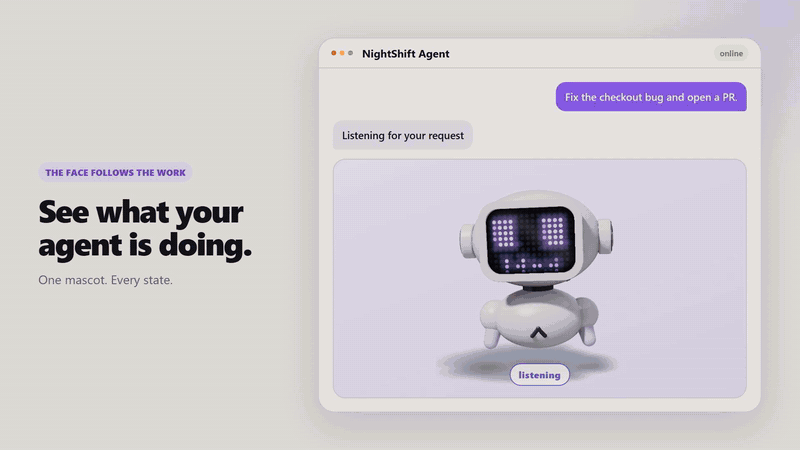
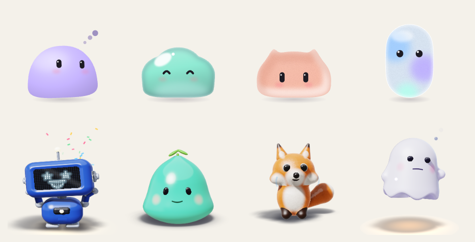
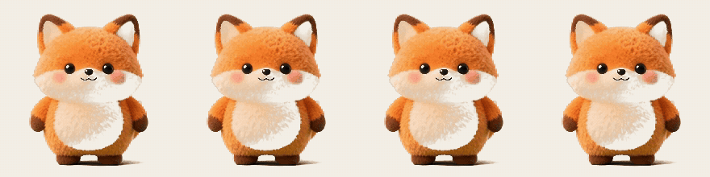
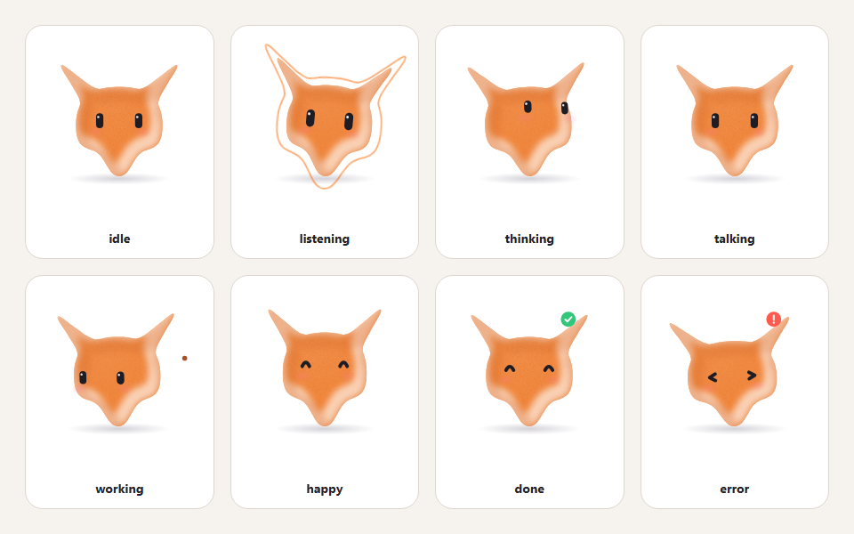
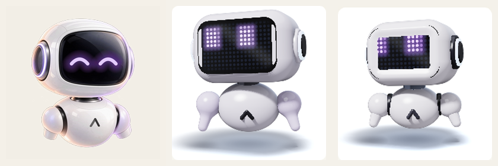

<div align="center">

# MascotForge

**Your users can't tell if your AI agent is thinking or stuck. Give it a face.**

Create an animated status mascot with idle, listening, thinking, talking, done, and error states. Export one Web Component and switch states with one `play()` call.

[**Create a mascot**](https://arivex-ca.github.io/mascotforge/) · [Install locally](#install-locally) · [Use it with an AI agent](#for-ai-agents) · [Français](README.fr.md)

<a href="https://arivex-ca.github.io/mascotforge/">
  
</a>

</div>

## Choose your path

Every path exports the same `<mascot-avatar>` component and the same `play(state)` API.

| Path | Best for | Cost | What you need |
|---|---|---:|---|
| **Blob** | A branded status face you can reshape and recolor | Free | A browser |
| **3D character** | A ready-made character with ten animated moods | Free | A browser |
| **AI video** | A mascot based on your image or text prompt | About $1 for four states | Your fal.ai key |

Blob and 3D mascots animate in the browser, follow the cursor, and call no third-party service. AI video uses Kling to animate a character in the states you choose.

## Put it in your agent

Copy the exported folder into your site, then add three lines:

```html
<mascot-avatar manifest="./mascot/manifest.json" label="My assistant"></mascot-avatar>
<script src="./mascot/mascot.js"></script>
<script>document.querySelector("mascot-avatar").play("thinking");</script>
```

Your interface can now show what the agent is doing:

```js
const mascot = document.querySelector("mascot-avatar");

mascot.play("listening");
mascot.play("thinking");
mascot.play("talking");
mascot.play("done");
mascot.play("error");
```

Common state names work across the Blob, 3D, and video paths. The widget also supports sleep, click reactions, cursor tracking, reduced motion, and immediate or loop-end state changes.

## Use it for

- **Chat assistants:** replace a spinner with listening, thinking, and talking states.
- **Coding agents:** show active work, completion, and errors without exposing internal logs.
- **Background tasks:** reassure users that a long process is still moving.
- **Voice agents:** give the conversation a responsive face without lip-sync work.

## Install locally

### Requirements

- Python 3.10 or newer
- ffmpeg and ffprobe for transparent AI video
- A fal.ai key only when you choose AI video

Blob and built-in 3D mascots need no provider key.

```bash
git clone https://github.com/Arivex-ca/mascotforge.git
cd mascotforge
python -m venv .venv
.venv/bin/pip install -r requirements.txt   # Windows: .venv\Scripts\pip
cp .env.example .env                        # optional: add FAL_KEY
.venv/bin/python -m uvicorn backend.main:app --port 8766 --env-file .env
```

Open:

- Studio: `http://localhost:8766/`
- Widget demo: `http://localhost:8766/widget/`

Without ffmpeg, generation still works and keeps the green background. `GET /api/health` reports whether ffmpeg and the server fallback key are available.

## What MascotForge produces

Everything below came from MascotForge.

<table>
  <tr>
    <td width="50%">
      
      <p><b>Free code mascots</b><br>Blob and 3D styles animate in the browser and follow the cursor.</p>
    </td>
    <td width="50%">
      
      <p><b>AI video states</b><br>This fox cost $1.01 for idle, thinking, talking, and error.</p>
    </td>
  </tr>
  <tr>
    <td width="50%">
      
      <p><b>Drawn by an agent</b><br>Codex created this fox over MCP, saw a cat in its first preview, and corrected the shape.</p>
    </td>
    <td width="50%">
      
      <p><b>Image to 3D</b><br>A vision model writes and checks a Wobnimo character from your reference image.</p>
    </td>
  </tr>
</table>

See the [full visual gallery](docs/gallery.md) for cursor tracking, studio screens, custom Blob shapes, and 3D moods.

## How it works

1. **Choose a character:** start with a Blob, a built-in 3D character, an image, or a prompt.
2. **Choose the states:** use a preset or define up to 12 states in your own words.
3. **Preview and correct:** inspect every state before you export. Agents can repeat this visual loop through MCP.
4. **Ship one component:** download the folder, add `<mascot-avatar>`, and call `play(state)` from your app.

The AI video path adds Kling generation and ffmpeg keying. The free paths render the mascot in code.

## For AI agents

MascotForge includes a CLI, an MCP server, and an Agent Skills skill. An agent can design a mascot, inspect the preview, correct it, and export the result without opening the studio.

```bash
python -m mascotforge styles
python -m mascotforge code --engine blob --set shape=cloud --out ./my-blob
python -m mascotforge code --engine 3d --set character=volt --out ./my-robot
python -m mascotforge mcp
python -m mascotforge skill
```

Free Blob and Wobnimo tools require no provider key. Paid video and image-to-3D tools show an estimate and stop until the user approves the cost.

Read the [agent and CLI reference](docs/technical-reference.md#agents-cli-and-mcp) for Claude Desktop, Cursor, Codex, JSON output, custom Blob specs, and Wobnimo visual correction.

## Want me to make the first one with you?

The first 10 mascots are on me. [Tell me what your agent does](https://github.com/Arivex-ca/mascotforge/issues/new?title=Mascot%20request%3A%20&body=What%20does%20your%20agent%20do%3F%0A%0AStyle%20%28blob%2C%203D%20or%20video%29%3A%0A%0AHow%20did%20you%20find%20MascotForge%3F%0A) and I will build yours by hand, free.

In return, I will ask three questions: would you install it, which states are missing, and what does your agent run on?

This is a real capacity limit. The self-serve studio, CLI, MCP server, and source code remain available to everyone.

## Cost and privacy

| Operation | Typical cost |
|---|---:|
| Blob or built-in 3D mascot | Free |
| AI video state, 3 seconds | About $0.25 |
| Four-state AI video mascot | About $1 |
| 3D interpretation from an image | About $0.15 to $0.60 |

You bring the provider key. The browser sends it through a dedicated header only when an operation needs it. MascotForge does not place keys in URLs, jobs, logs, exports, or API responses.

Do not configure a shared server fallback key on a public instance. Visitors without their own key would spend from that account.

Read the [technical reference](docs/technical-reference.md) for provider models, exact costs, security behavior, API routes, export format, widget attributes, and cursor tracking.

## Test

```bash
.venv/bin/python -m pytest tests/ -v
```

Provider calls are mocked. The alpha test runs real ffmpeg against a synthetic clip. Browser tests run when Playwright is installed.

## Documentation

- [Technical reference](docs/technical-reference.md)
- [Visual gallery](docs/gallery.md)
- [Contributing](CONTRIBUTING.md)
- [Engine provenance and licenses](engines/README.md)
- [MascotForge Agent Skill](skills/mascotforge/SKILL.md)
- [French README](README.fr.md)

The studio, CLI help, and API errors are in French for now. Issues and pull requests in English are welcome.

## License

MascotForge uses the MIT license. See [LICENSE](LICENSE).

Blob Atelier by Victoria Wu and Wobnimo by Pourya Akhbari keep their MIT licenses. Their license files ship beside the engines in every related export.

Made by [Arivex](https://arivex.ca), which builds AI agents for businesses.

