# MascotForge (text-to-mascot)

Give your AI agent a face: describe a mascot or upload an image, choose its animation states, and get an animated mascot with a transparent background, ready for your site or AI agent.

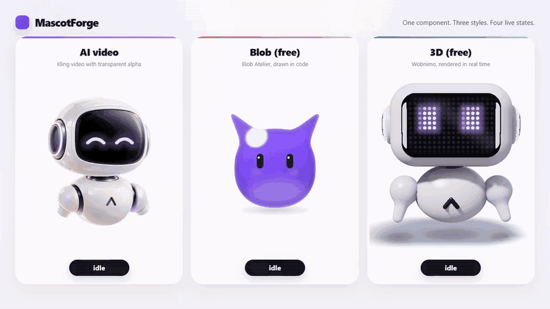

[Français](README.fr.md)

```html
<mascot-avatar manifest="./mascot/manifest.json" label="My assistant"></mascot-avatar>
<script src="./mascot/mascot.js"></script>
<script>document.querySelector("mascot-avatar").play("thinking");</script>
```

**The first 10 mascots are on me.** [Tell me what your agent does](https://github.com/Arivex-ca/mascotforge/issues/new?title=Mascot%20request%3A%20&body=What%20does%20your%20agent%20do%3F%0A%0AStyle%20%28blob%2C%203D%20or%20video%29%3A%0A%0AHow%20did%20you%20find%20MascotForge%3F%0A) and I'll make yours by hand, free. In return, three questions: would you install it, which states are missing, and what does your agent run on?

Three styles, one `<mascot-avatar>` widget, and one `play(state)` API:

- **AI video**: Kling animates your character with states you define through the pipeline below.
- **Code Blob**: Blob Atelier by Victoria Wu, MIT, free and instant.
- **Code 3D**: Wobnimo by Pourya Akhbari, MIT, 20 characters, free and instant.

The studio, the CLI help and the API error messages are in French for now.
Issues and pull requests in English are welcome: see
[CONTRIBUTING.md](CONTRIBUTING.md).

## Gallery

MascotForge produced everything shown below.

**AI video**: a plush fox, built from one image that Claude Code generated,
animated by Kling in four states: idle, thinking, talking, and error. The green
background is removed and the loops are seamless. The preview places it on a
cream background. Cost: $1.01 for four states.

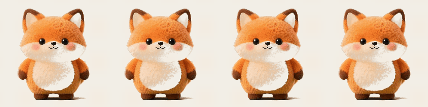

**Cursor tracking**, shown here with the Arivex robot: an 8-second clip in
which only the head looks in four directions. While idle, the widget displays
the frame that looks toward the mouse.


**Code mascots**: four Blob Atelier blobs and four Wobnimo characters,
configured in the studio, each in a different state. They are free, animate in
the browser, and follow the cursor.


**Drawn by an agent**: Codex designed this fox on its own over MCP, with no API
key. After the first preview it decided the shape looked like a cat, then fixed
it.

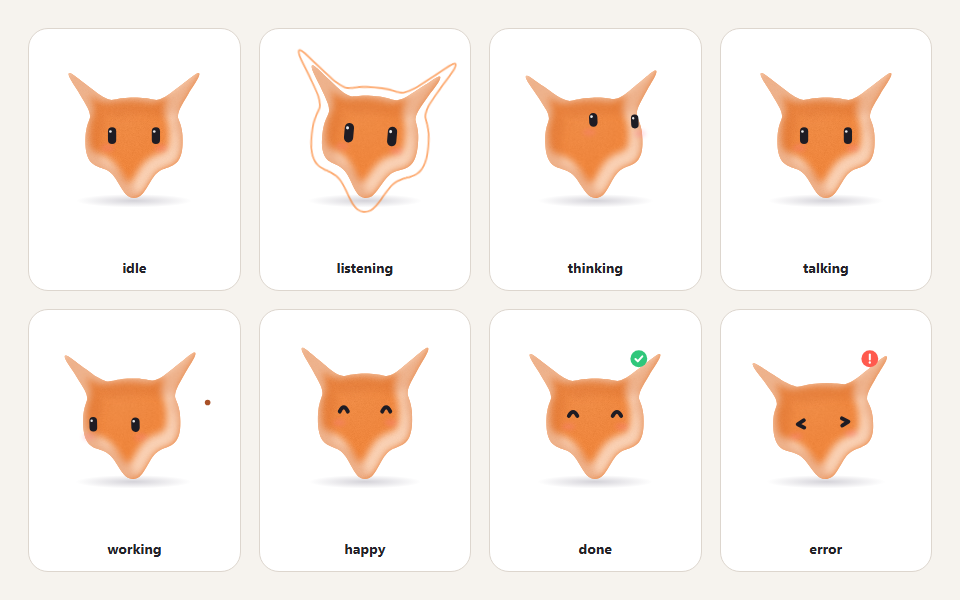

**Base image generated by the agent**: no image to start from and no fal key?
Claude Code generated these four plush characters itself, with the free
Z-Image Turbo model through its Hugging Face connector, following the
MascotForge skill. The chosen image then goes to the video, image-to-3D, or
Wobnimo path.

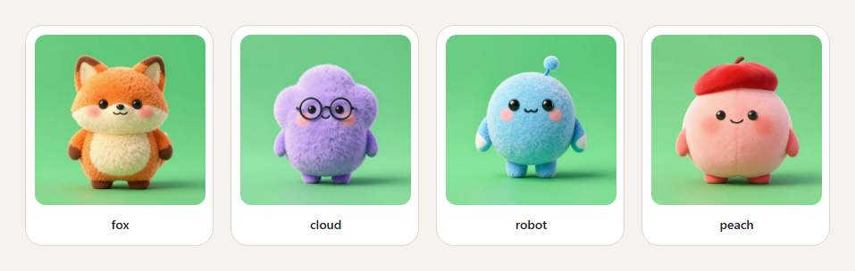

**3D character from an image**: the source image on the left, followed by two
Wobnimo characters written by a model from that image: Visor, then Glimmer with
visual comparison. The result is an interpretation in Wobnimo's style, not a
copy. It costs about $0.13 to $0.40 per character.


The same character in ten moods from four angles:


### The studio

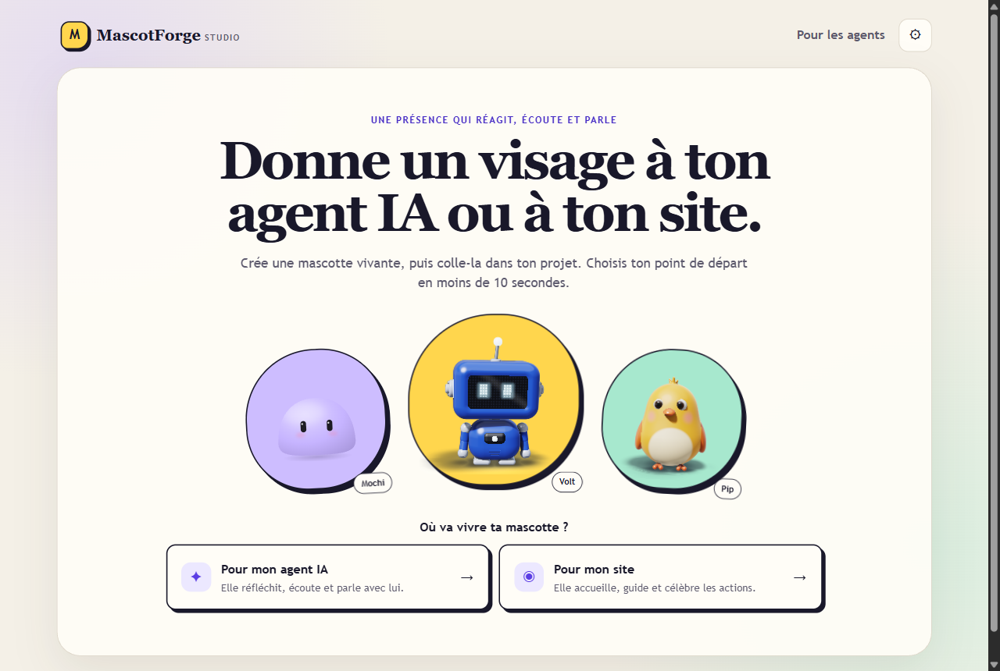

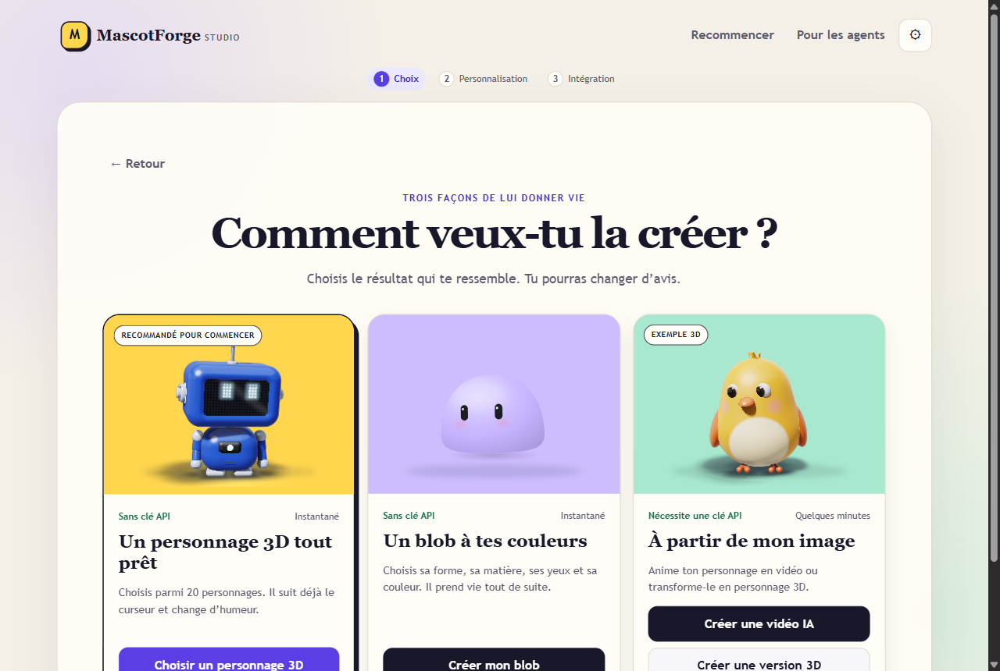

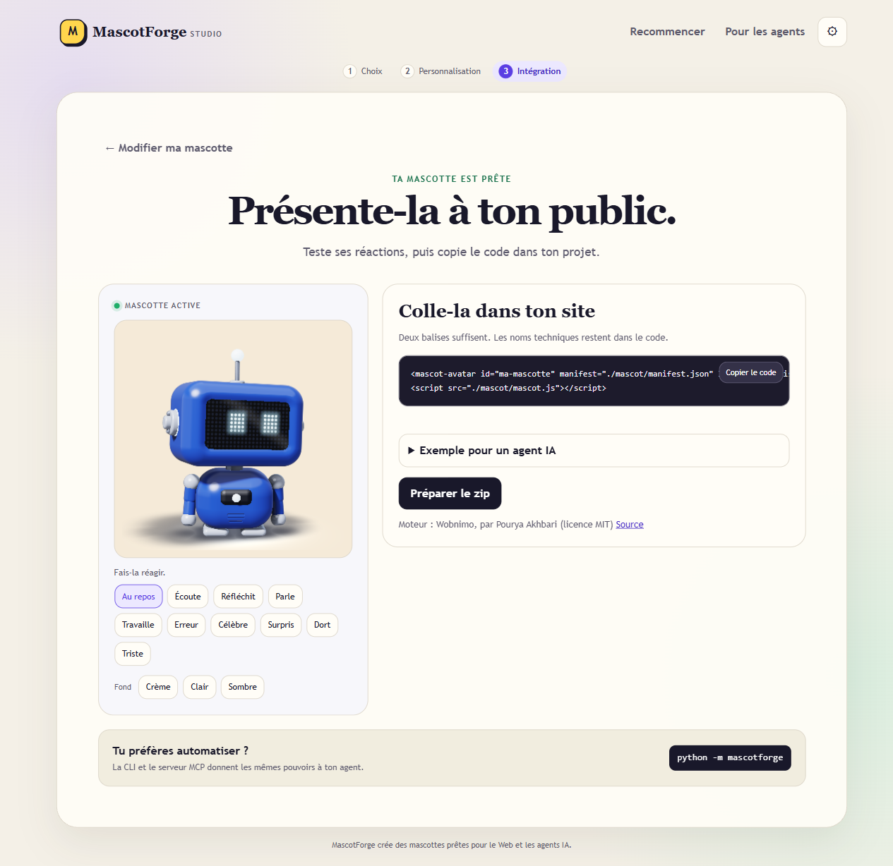

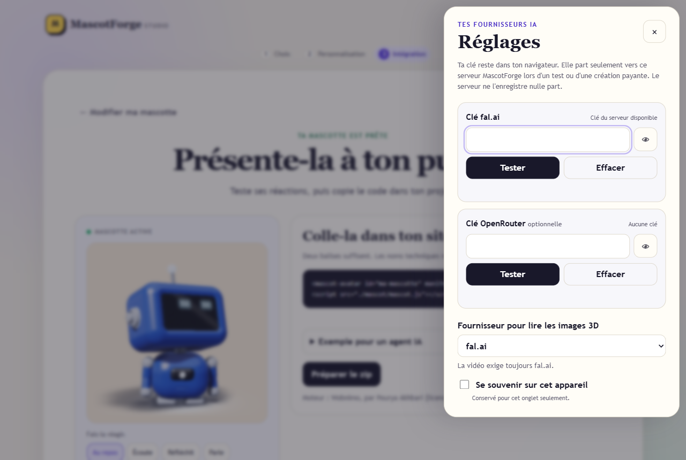

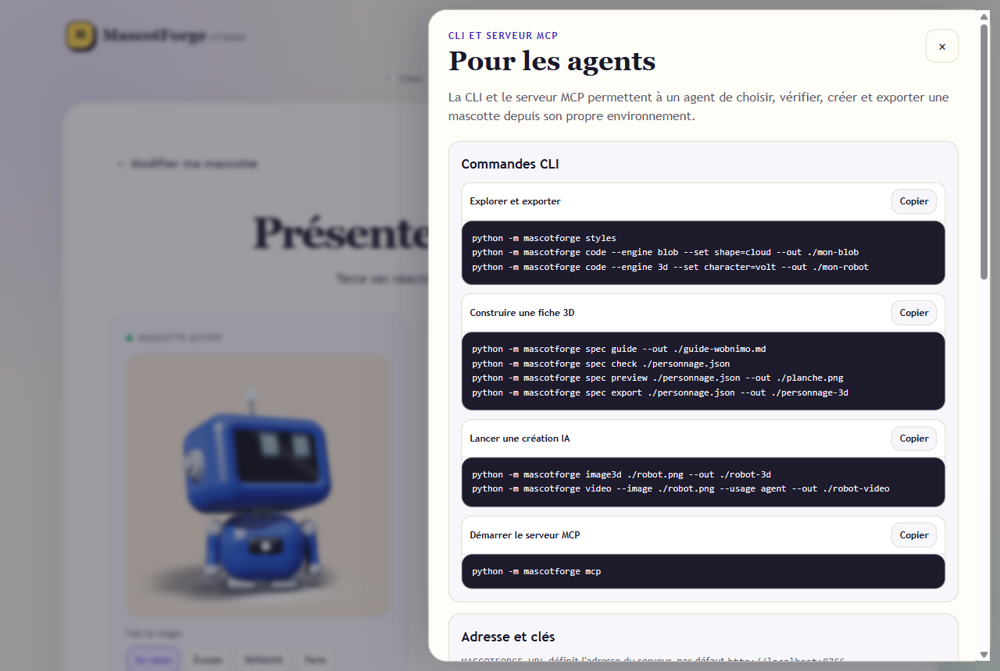

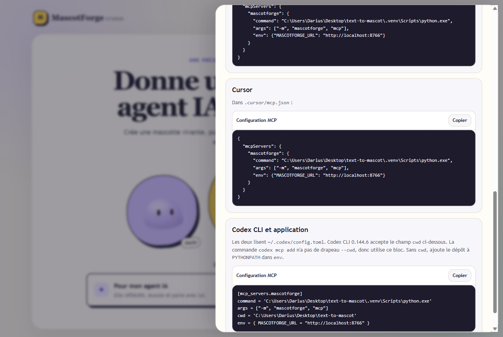

Pipeline:

1. Character: upload an image, preferably a cut-out PNG, or enter a text prompt.
   Flux generates the character on a solid green background. Uploaded images
   are placed on the same green.
2. States on demand: start from a preset for AI agents, websites, or the full
   set, then add, remove, or freely describe up to 12 states. Each state is a
   3-second clip that loops or plays once.
3. Kling 3.0 image-to-video generates one clip per state. Each clip starts and
   ends on the source image through `end_image_url`. Loops stay seamless, and
   the widget switches states on the shared pose. Audio is disabled.
4. ffmpeg keying removes the green. Each clip becomes a 480 px stacked-alpha
   video with color on top and the mask below.
5. The `<mascot-avatar>` widget rebuilds transparency in WebGL across browsers,
   including Safari and iOS.
6. Export produces an importable folder and a zip archive.

## Requirements

- Python 3.10 or newer
- ffmpeg and ffprobe on the PATH, or `MASCOTFORGE_FFMPEG`. Generation still
  works without them, but mascots keep their green background. `GET /api/health`
  reports their availability.
- For AI video only, a **fal.ai** key entered in the studio Settings. Blob and
  3D mascots need no key. `FAL_KEY` remains a useful
  fallback for a local server. Without an available key, generation routes
  return `503` with a clear message.

## Installation

```bash
git clone https://github.com/Arivex-ca/mascotforge.git
cd mascotforge
python -m venv .venv
.venv/bin/pip install -r requirements.txt   # Windows: .venv\Scripts\pip
cp .env.example .env                        # then set FAL_KEY
```

## Run

```bash
.venv/bin/python -m uvicorn backend.main:app --port 8766 --env-file .env
```

`--env-file` loads `FAL_KEY` and local settings from `.env`. User-owned keys
arrive through dedicated headers.

- Studio: `http://localhost:8766/`
- Widget and demo: `http://localhost:8766/widget/`

## Key settings and security

The studio Settings button accepts a fal.ai key and an optional OpenRouter key.
Without "Remember on this device," the studio uses `sessionStorage`. With the
option enabled, it uses `localStorage`. All access to these stores falls back
to memory if the browser blocks them.

The browser sends the required key in an `X-Fal-Key` or `X-OpenRouter-Key`
header only when an operation needs it. The 3D image reader provider travels in
`X-Vision-Provider: fal|openrouter`. Keys never enter a URL or query parameter.
The server keeps a key in the request and task context. It does not write keys
to jobs, `data/`, logs, or responses.

`FAL_KEY` is the local fallback when `X-Fal-Key` is missing. `GET /api/health`
therefore continues to report only the server key. The studio displays the
state of the browser key separately.

Do not set `FAL_KEY` on a server that other people can reach: every visitor
without a key would generate videos on your fal account. The monthly cap
(`MASCOTFORGE_MONTHLY_CAP_USD`) is also shared by everyone using the server.

The Test button starts no generation. OpenRouter checks the key with
`GET https://openrouter.ai/api/v1/key`. fal.ai uses the `fal-client` storage
token request without uploading a file or running inference.

## For agents

The CLI and MCP server use the existing API. Configure the server address with
`MASCOTFORGE_URL`, which defaults to `http://localhost:8766`. To provide keys
without placing them in a URL or output, use `MASCOTFORGE_FAL_KEY` and
`MASCOTFORGE_OPENROUTER_KEY`. The client sends them through the two dedicated
headers.

### CLI

```bash
python -m mascotforge styles
python -m mascotforge code --engine blob --set shape=cloud --out ./mon-blob
python -m mascotforge code --engine 3d --set character=volt --out ./mon-robot
python -m mascotforge blob guide --out ./guide-blob.md
python -m mascotforge blob check ./blob.json
python -m mascotforge blob preview ./blob.json --out ./planche-blob.png
python -m mascotforge blob export ./blob.json --out ./blob-sur-mesure
python -m mascotforge image3d ./robot.png --out ./robot-3d
python -m mascotforge video --image ./robot.png --usage agent --out ./robot-video
python -m mascotforge video --prompt "un petit renard orange" --usage site --out ./renard
python -m mascotforge video --image ./renard.png --states ./etats.json --out ./renard
python -m mascotforge status ID
python -m mascotforge export ID --out ./export
python -m mascotforge cost
```

### Free loop: the agent draws the mascot itself

For a blob outside the eight built-in shapes, the agent describes a
superellipse and its bumps in a JSON spec. `blob check` rejects intersections,
outlines that are too thin, too small, or too large, and out-of-range values.
`blob preview` displays all eight states before the standalone export. The
guide includes a two-horned blob, a star, and a twisted bean.

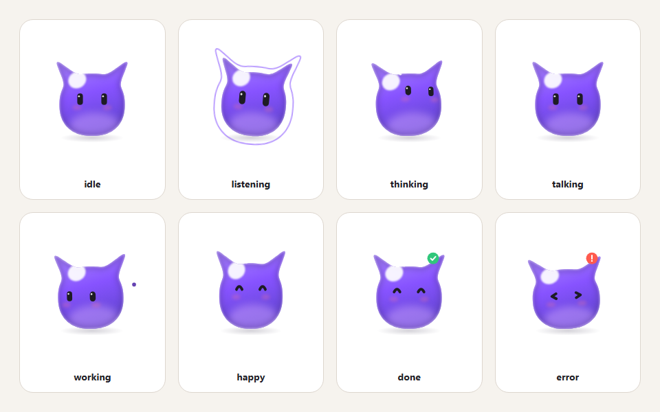

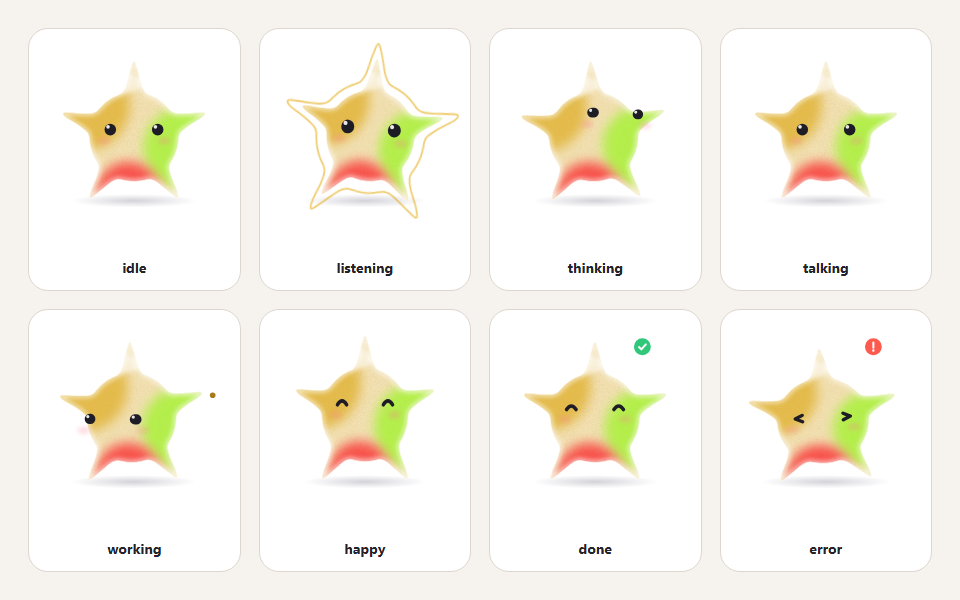

```bash
python -m mascotforge blob guide --out ./guide-blob.md
python -m mascotforge blob check ./blob.json
python -m mascotforge blob preview ./blob.json --out ./planche-blob.png
python -m mascotforge blob export ./blob.json --out ./blob-sur-mesure
```

An agent that can see an image can write the Wobnimo spec directly, without a
fal.ai call or cost. The server retains the checker, renderer, Node runtime,
and storage. The loop is visual:

1. Inspect the reference image and read the guide.
2. Write the JSON spec, then run the check.
3. Generate the sheet and compare its front view in the top-left corner with
   the source image.
4. Correct the spec, then repeat the check and preview.
5. Save the spec or export it when the result is accurate.

```bash
python -m mascotforge spec guide --out ./guide-wobnimo.md
python -m mascotforge spec check ./personnage.json
python -m mascotforge spec preview ./personnage.json --out ./planche.png
python -m mascotforge spec save ./personnage.json
python -m mascotforge spec export ./personnage.json --out ./personnage-3d
```

These commands are free and do not require `--yes`. The `image3d` command is
the paid option where a fal.ai model writes the spec.

Add `--json` to a command for agent-readable output. The `image3d` and `video`
commands are paid. Without `--yes`, they display the estimated price and exit
with a non-zero status before starting. Run the command again with `--yes`
only after the user agrees.

### MCP over stdio

```bash
python -m mascotforge mcp
```

Long-running creations use three calls: `mascotforge_video_start` or
`mascotforge_image3d_start`, followed by `mascotforge_status`, then
`mascotforge_export`. Paid start tools require `user_confirmed=true`. Their
descriptions require the agent to state the price and obtain explicit consent.

The free `mascotforge_spec_guide`, `mascotforge_spec_check`,
`mascotforge_spec_preview`, `mascotforge_spec_save`, and
`mascotforge_spec_export` tools follow the same loop. The preview returns as an
MCP image so the agent can inspect the sheet, compare it with the reference,
and correct the spec before saving it.

The four custom Blob tools are `mascotforge_blob_guide`,
`mascotforge_blob_check`, `mascotforge_blob_preview`, and
`mascotforge_blob_export`. Their preview also returns as an MCP image.

Claude Desktop configuration in `%APPDATA%\Claude\claude_desktop_config.json`:

```json
{
  "mcpServers": {
    "mascotforge": {
      "command": "C:\\path\\to\\text-to-mascot\\.venv\\Scripts\\python.exe",
      "args": ["-m", "mascotforge", "mcp"],
      "env": {"MASCOTFORGE_URL": "http://localhost:8766"}
    }
  }
}
```

Cursor configuration in `.cursor/mcp.json`:

```json
{
  "mcpServers": {
    "mascotforge": {
      "command": "C:\\path\\to\\text-to-mascot\\.venv\\Scripts\\python.exe",
      "args": ["-m", "mascotforge", "mcp"],
      "env": {"MASCOTFORGE_URL": "http://localhost:8766"}
    }
  }
}
```

Codex CLI and app configuration in `~/.codex/config.toml`:

```toml
[mcp_servers.mascotforge]
command = 'C:\path\to\text-to-mascot\.venv\Scripts\python.exe'
args = ["-m", "mascotforge", "mcp"]
cwd = 'C:\path\to\text-to-mascot'
env = { MASCOTFORGE_URL = "http://localhost:8766" }
```

The Codex CLI and app read the same file. Codex CLI 0.144.6 accepts `cwd`. Its
`codex mcp add` command has no `--cwd` flag, so the TOML block remains the full
configuration. If you remove `cwd`, add
`PYTHONPATH = 'C:\path\to\text-to-mascot'` to the `env` table so Python can
find the module from another directory.

With `codex exec`, nobody is there to approve a tool call, so Codex cancels it
("user cancelled MCP tool call"). Add
`default_tools_approval_mode = "approve"` to this block and run
`codex exec -c 'approval_policy="never"'`. Tested with Codex CLI 0.144.6.

### Agent Skills skill

The source skill lives in `skills/mascotforge/SKILL.md`. It guides an agent to
the matching free path, requires the visual loop for a 3D spec, and blocks any
paid creation until the estimate is shown and the user explicitly agrees.

Install it for Claude and Agent Skills-compatible agents in the current folder:

```bash
python -m mascotforge skill
```

To target another project:

```bash
python -m mascotforge skill --dir DOSSIER
```

The command copies the skill to `.claude/skills/mascotforge/` and
`.agents/skills/mascotforge/`. It preserves modified local files. Use `--force`
only after the user confirms replacement.

## API

| Method | Route | Description |
|---|---|---|
| GET | `/api/health` | `{"ok", "fal_key_configured", "ffmpeg_available"}` |
| POST | `/api/keys/test` | `{"provider":"fal"|"openrouter"}` with the key in a header, then `{"ok", "message"}` |
| GET | `/api/presets` | state presets, cost per state, maximum state count |
| POST | `/api/character/from-prompt` | `{"prompt"}` -> `{"character_id", "image_url"}` (429 at the cap) |
| POST | `/api/character/from-upload` | multipart `file`, 10 MB maximum -> `{"character_id", "image_url"}` |
| POST | `/api/generate` | `{"character_id", "states": [{"name", "prompt", "loop"}]}` or `{"character_id", "usage"}` -> `{"job_id"}` |
| GET | `/api/jobs/{job_id}` | status, states (`video_url`, `model`, `error`, `loop`), estimated and actual cost |
| POST | `/api/jobs/{job_id}/retry` | retry only failed states (409 when none failed) |
| POST | `/api/jobs/{job_id}/states/{state}/regenerate` | `{"prompt"?}`: generate one state again |
| POST | `/api/jobs/{job_id}/look` | `{"prompt"?}`: add or regenerate cursor tracking with an 8-second clip |
| GET | `/api/jobs/{job_id}/manifest.json` | widget manifest for the preview |
| POST | `/api/export/{job_id}` | `{"download_url"}` (409 until the job finishes) |
| GET | `/api/engines` | code styles, settings, states, and credits |
| GET | `/api/engines/{engine}/manifest.json?<settings>` | preview manifest for a code mascot (400 for rejected settings) |
| POST | `/api/engines/{engine}/export` | `{"config"}` -> `{"download_url"}`: zip with the engine and its license |
| GET | `/api/exports/{filename}` | download the zip |
| GET | `/videos/{job_id}/{state}.mp4` | keyed clip |
| GET | `/api/cost` | `{"month", "spent_usd", "reserved_usd", "cap_usd", "mascots_completed"}` |

Error messages are in French in the `detail` field and contain no em dash.
fal.ai and ffmpeg errors stay in server logs. The API returns a clean message.

Paid routes accept `X-Fal-Key`. 3D creation from an image also accepts
`X-OpenRouter-Key` and `X-Vision-Provider`. No secret is accepted in a URL or
query parameter.

## fal.ai models

Environment variables can override these models:

- Text-to-image: `fal-ai/flux/dev` (`MASCOTFORGE_TTI_MODEL`)
- Image-to-video: `fal-ai/kling-video/v3/standard/image-to-video`
  (`MASCOTFORGE_I2V_MODEL`). Schema read on 2026-10-30: required
  `start_image_url`, optional `end_image_url`, `generate_audio`, duration from
  `"3"` to `"15"`.
- Fallback: `fal-ai/kling-video/v3/pro/image-to-video` (`MASCOTFORGE_FALLBACK_MODEL`)

## Costs

- $0.084/s for Kling 3.0 standard without audio, from the fal.ai pricing page
  on 2026-10-30. A 3-second state costs about $0.25. A four-state mascot costs
  about $1, plus $0.025 when the image comes from a prompt.
- `MASCOTFORGE_MONTHLY_CAP_USD` sets the monthly cap, $50 by default. The
  counter lives in `data/cost.json`. Each job reserves its estimate before it
  starts, so two simultaneous jobs cannot exceed the cap together.
- A generated clip is counted even when its download fails. Retrying downloads
  it again without paying for generation again.
- Cursor tracking uses one 8-second clip and costs about $0.67.
- The pro model price is an estimate that must be checked on the fal.ai pricing page.

## Export

`POST /api/export/{job_id}` assembles `exports/mascot-{id}/mascot/`:

- `mascot.js`: the widget
- `manifest.json` v2: `{"default_state", "alpha": "stacked", "states": {"idle": {"src", "loop"}, ...}, "models"}`
- `videos/*.mp4`: one clip per state
- `README.md`: integration instructions generated from the states

## Widget

```html
<mascot-avatar manifest="./mascot/manifest.json" label="My assistant"></mascot-avatar>
<script src="./mascot/mascot.js"></script>
<script>
  document.querySelector("mascot-avatar").play("thinking");
</script>
```

Attributes: `click-state`, which defaults to `clicked` when present;
`sleep-state`, which defaults to `sleeping` when present; `sleep-after` in
seconds, where 0 disables it; `switch`, with `loop-end` as the default or
`immediate`; `parallax`; `follow-cursor`; and `label`. The widget also reads
V1 manifests from V2.

### Code mascots

The studio offers two styles without AI or cost at the top of the page:

| Style | Engine | Settings | States |
|---|---|---|---|
| `blob` | Blob Atelier, Victoria Wu, MIT | shape (8), material (6), color (11 or `#rrggbb`), eyes, cheeks | idle, listening, thinking, talking, working, happy, done, error |
| `3d` | Wobnimo, Pourya Akhbari, MIT | character (20, including the LED robot Volt) | idle, listening, thinking, speaking, working, error, celebrating, surprised, sleeping, sad |

The manifest contains `"engine"`, `"engine_src"` for the engine shipped next
to it in `engines/`, and `"engine_config"`. The widget loads the engine once
per page and relays `play()`. Common names cross engines, including `talking`
and `speaking`, or `happy` and `celebrating`. These mascots follow the cursor
themselves and call no third-party server. MascotForge excludes Blob Atelier's
3D animals because they load three.js from an external CDN. See
`engines/README.md` for engine provenance, versions, and hashes.

### 3D character from an image

In the 3D style, the "From your image" tab creates a custom Wobnimo character:

1. With fal.ai, the image goes to its storage. With direct OpenRouter, the
   server converts the image to a base64 data URL in memory and does not send
   it to fal.ai storage.
2. An image-reading model, set by `MASCOTFORGE_SPEC_MODEL` and defaulting to
   `anthropic/claude-sonnet-5.5`, writes the JSON character spec from the
   Wobnimo guide bundled in `engines/wobnimo/skill/`. fal.ai mode uses
   `openrouter/router/vision`. OpenRouter mode calls
   `/api/v1/chat/completions` directly with reasoning enabled.
3. Wobnimo's checker in `engines/wobnimo/dist/cli.js`, run with Node 18 or
   newer, measures the actual 3D geometry. Its errors and exact fixes return to
   the model for up to three passes.
4. The checker does not judge visual similarity. The server renders the spec
   with `wobnimo preview`, which opens Chrome or Edge headlessly. Set
   `MASCOTFORGE_BROWSER` if the browser is not found. The model receives the
   source image beside the render and returns OK or a corrected spec. The
   correction goes through the checker again, and a correction that breaks
   geometry is discarded. The server performs at most two comparisons and
   skips this step when no browser is available.
5. The validated spec appears in the widget through `"engine_spec"` in the
   manifest and ships in the export.

Cost: the actual provider cost for each call, about $0.15 to $0.60 per
character depending on pass count. MascotForge reserves $1 under the cap while
creating the character. OpenRouter normally returns `usage.cost`. When the
field is missing, MascotForge estimates the cost from `usage` tokens and marks
the estimate in the studio. The result remains an interpretation in Wobnimo's
style. At idle, the LED screen eyes remain those of the engine.

| Method | Route | Description |
|---|---|---|
| POST | `/api/engines/3d/from-image` | multipart `file` -> `{"spec_id"}` (503 without the selected provider key or Node) |
| GET | `/api/engines/3d/specs/{spec_id}` | status, name, passes, warnings, cost, and `cost_estimated` |

Use the spec with `{"spec": spec_id}` instead of `{"character": ...}` for
both preview and export.

### Cursor tracking

The studio offers cursor tracking in step 3. Kling generates an 8-second clip
in which only the head looks left, right, up, and down, starting and returning
to the reference pose. During keying, the pipeline aligns the inside of the
head against the first image to measure the gaze direction in every frame. It
writes the result to the manifest as `"look": {"src", "fps", "map"}`. The
clip keeps 12 frames per second, with every frame as a keyframe.

While idle, the widget does not play the clip. It displays the frame whose gaze
is closest to the cursor with smoothing, then returns to the idle loop 2.5
seconds after the last movement. Any `play()` call stops tracking. The clip
loads only after the first mouse movement. Tracking stays off on touch devices,
with `prefers-reduced-motion`, or with `follow-cursor="false"`.

## Tests

```bash
.venv/bin/python -m pytest tests/ -v
```

fal.ai is mocked, so tests make no network call and spend nothing.
`tests/test_alpha.py` runs the real ffmpeg against a synthetic clip.
`tests/test_widget_chromium.py` skips when Playwright is not installed.
`widget/smoke.html` runs in a browser.

Made by [Arivex](https://arivex.ca), which builds AI agents for businesses.

## License

MascotForge uses the MIT license. See `LICENSE`. You may use, modify,
redistribute, and sell it as long as you keep the copyright notice and license
text. The widget carries the notice in its header, so every export includes it.

Third-party engines in `engines/` retain their authors' MIT licenses: Blob
Atelier by Victoria Wu and Wobnimo by Pourya Akhbari. Their `LICENSE` files
stay beside them and ship in every export that uses them. See
`engines/README.md`.

## Files

- `backend/main.py`: FastAPI app, routes, static files
- `backend/states.py`: state presets and custom state validation
- `backend/fal.py`: fal.ai client for upload, text-to-image, and image-to-video
- `backend/openrouter.py`: direct OpenRouter client for image reading
- `backend/alpha.py`: green background, ffmpeg keying, gaze measurement
- `backend/pipeline.py`: jobs, fallback, download, retry, restart recovery
- `backend/cost.py`: monthly counter, reservations, cap
- `backend/exporter.py`: V2 manifest, importable folder, zip
- `backend/engines.py`: code mascots, engines, settings, manifests
- `backend/image3d.py`: image to Wobnimo 3D character with a vision model, checker, and corrections
- `engines/`: unmodified Blob Atelier and Wobnimo code with their MIT licenses
- `widget/mascot-avatar.js`: the web component
- `studio/`: creation interface
- `skills/mascotforge/`: Agent Skills skill for creating and integrating a mascot
