# Galerie visuelle MascotForge

MascotForge a produit chaque élément de cette page.

[Retour au README](../README.fr.md)

## États en vidéo IA

Claude Code a généré l'image de base de ce renard peluche. Kling l'a animé en quatre états : repos, réflexion, parole et erreur. MascotForge a retiré le fond vert et produit des boucles sans saut. Les quatre états ont coûté 1,01 $.

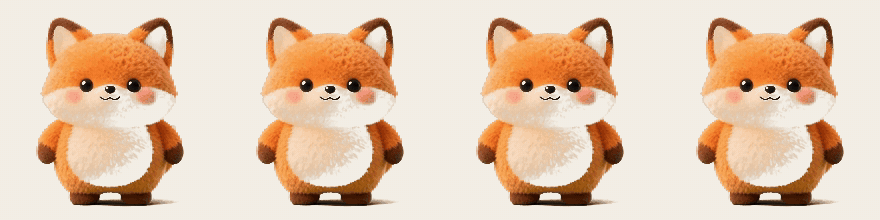

## Suivi du curseur

MascotForge a généré un clip de huit secondes dans lequel le robot Arivex regarde à gauche, à droite, en haut et en bas. Au repos, le widget affiche l'image qui regarde vers la souris.

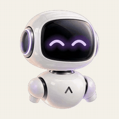

## Mascottes gratuites en code

Ces quatre mascottes Blob Atelier et quatre personnages Wobnimo s'animent dans le navigateur. Chacun utilise le même composant `<mascot-avatar>` et suit le curseur sans appel fournisseur.

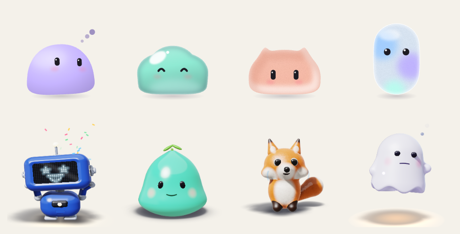

## Une mascotte dessinée par un agent

Codex a conçu ce renard par le serveur MCP MascotForge. Il a inspecté le premier aperçu, jugé que la forme ressemblait à un chat, corrigé la fiche JSON et exporté le résultat sans clé fournisseur.

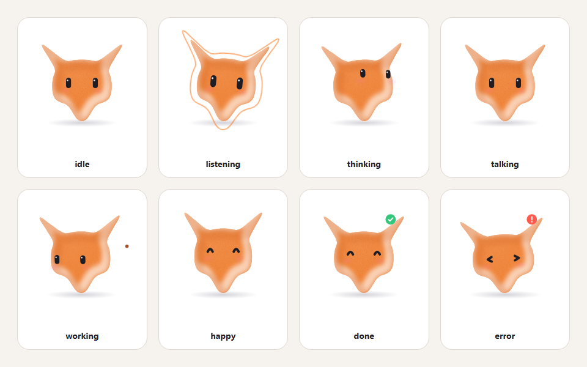

## Images de base générées par un agent

Claude Code a généré ces quatre peluches avec Z-Image Turbo par son connecteur Hugging Face. L'image retenue peut continuer vers la vidéo IA ou le parcours image vers 3D.

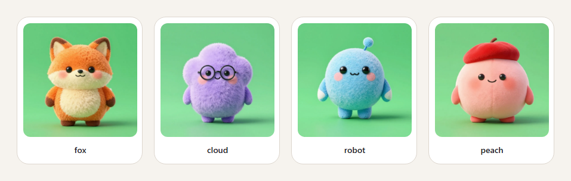

## Image vers 3D

L'image source apparaît à gauche. Un modèle de vision a ensuite écrit deux interprétations Wobnimo : Visor et Glimmer. Le second passage a inclus une comparaison visuelle. Un résultat coûte environ 0,15 à 0,60 $, selon le nombre de corrections.

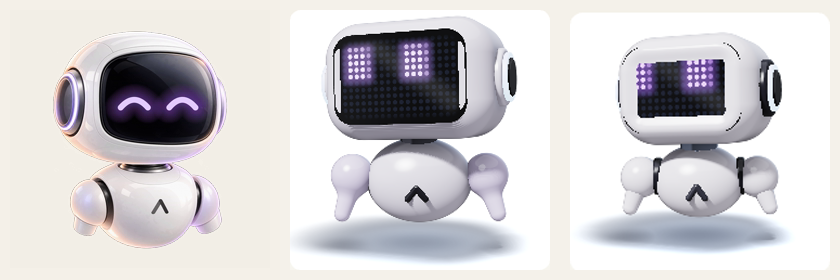

## Dix humeurs sous quatre angles

Le même personnage Glimmer rendu dans dix états et sous quatre angles.

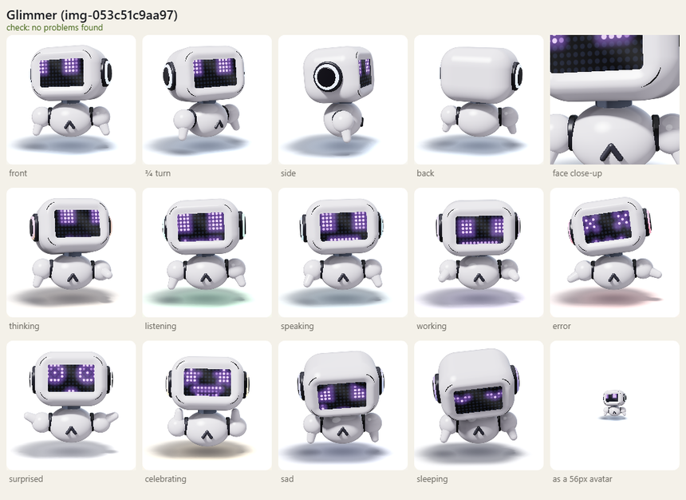

## Formes Blob personnalisées

Un agent peut écrire et vérifier une fiche Blob personnalisée avant l'export.

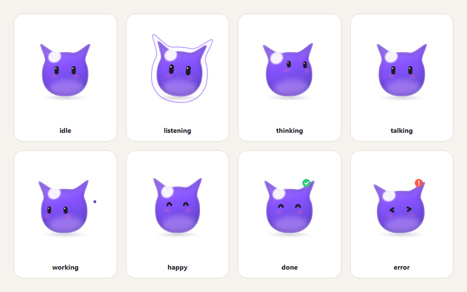

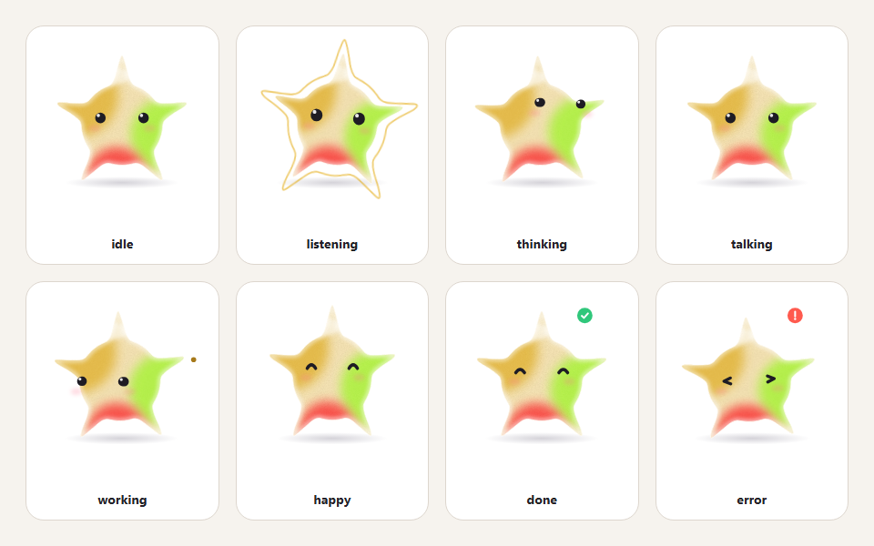

## Le studio

### Accueil

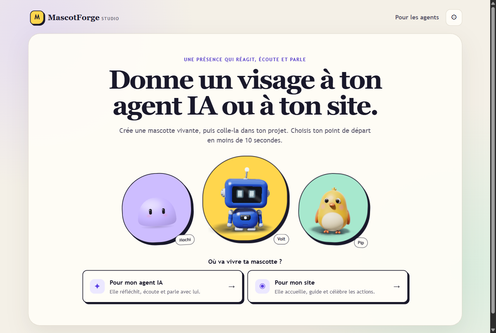

### Choix du parcours

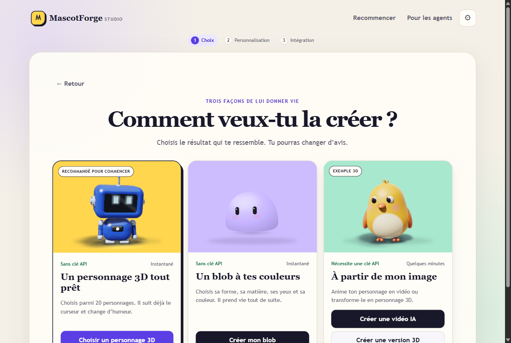

### Intégration du résultat

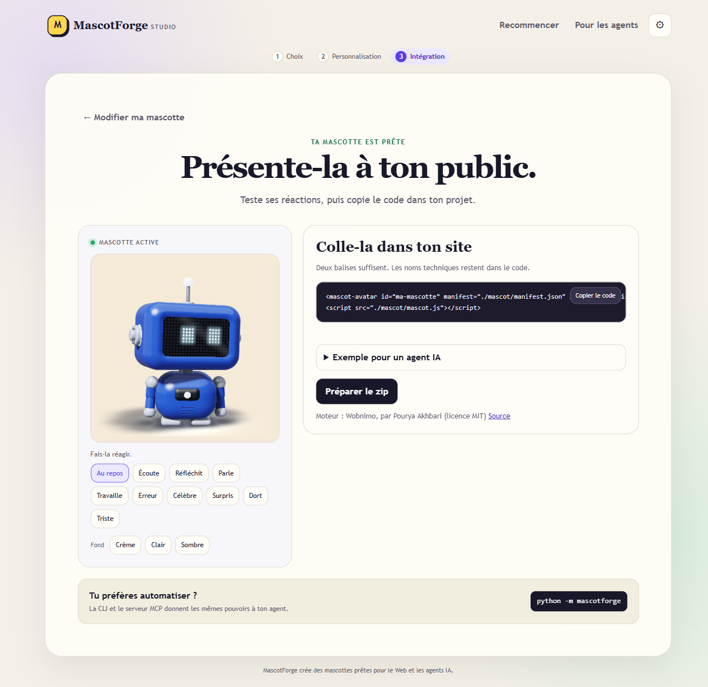

### Configuration des clés

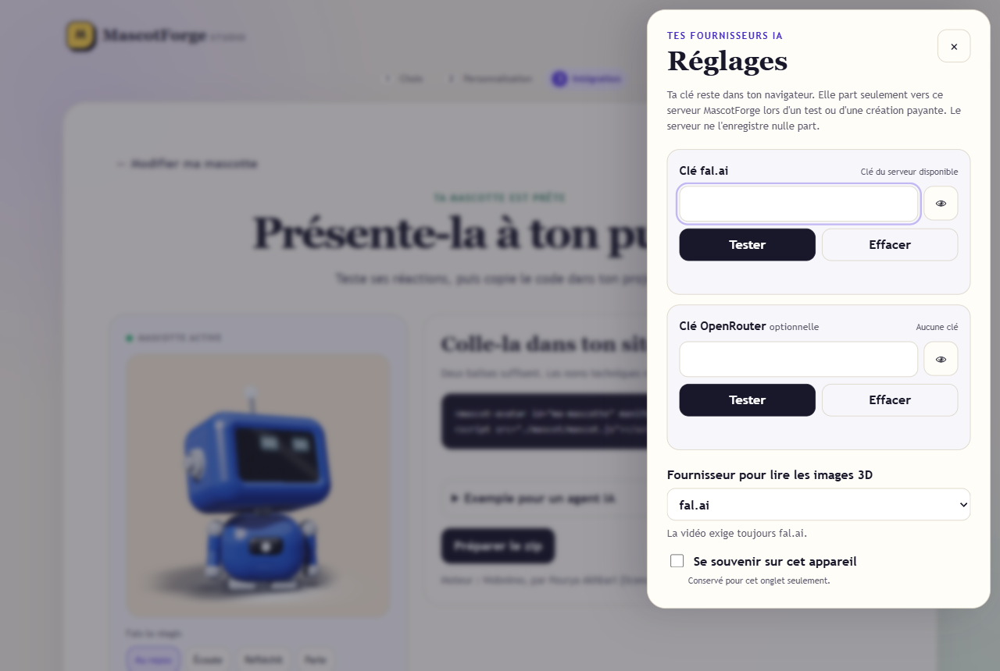

### Connexion d'un agent

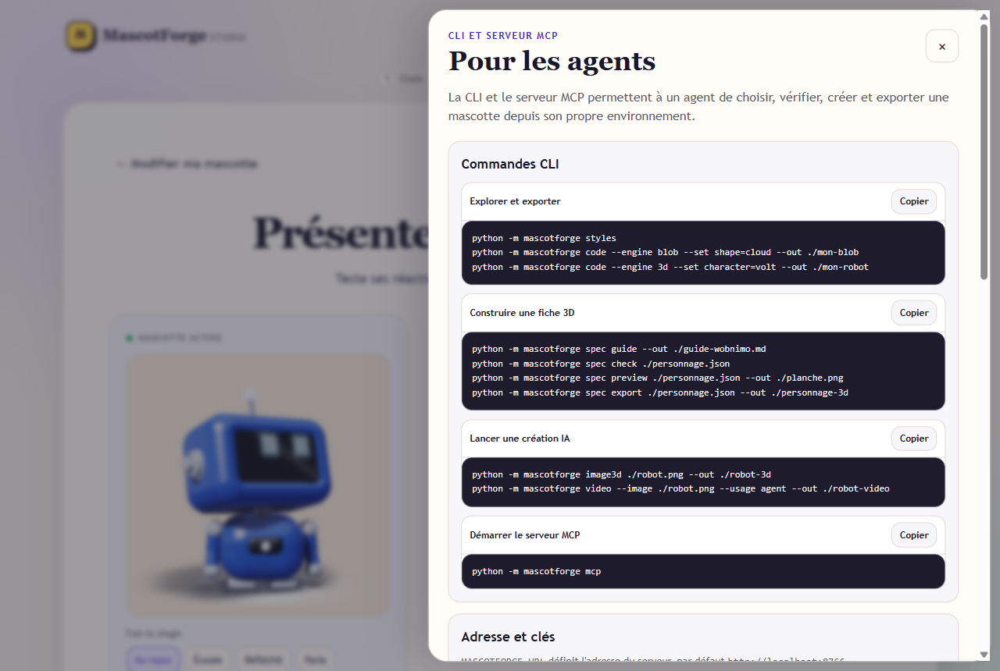

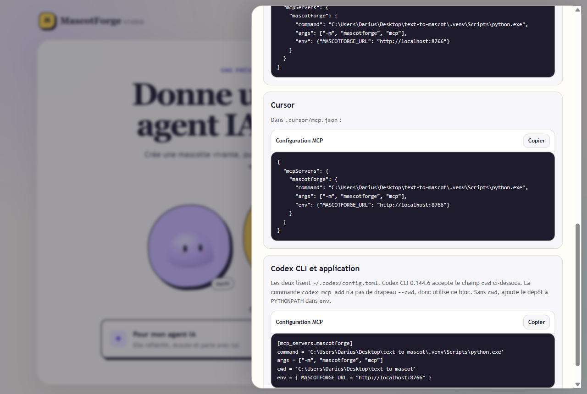

[Créer une mascotte](https://arivex-ca.github.io/mascotforge/) · [Lire la référence technique](technical-reference.fr.md)

