# MascotForge visual gallery

Everything on this page came from MascotForge.

[Back to the README](../README.md)

## AI video states

Claude Code generated the base image for this plush fox. Kling animated it in four states: idle, thinking, talking, and error. MascotForge removed the green background and produced seamless loops. The four states cost $1.01.

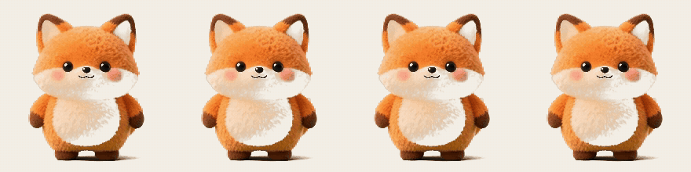

## Cursor tracking

MascotForge generated an eight-second clip in which the Arivex robot looks left, right, up, and down. The widget displays the frame that looks toward the mouse while the mascot is idle.

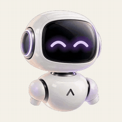

## Free code mascots

These four Blob Atelier mascots and four Wobnimo characters animate in the browser. Each uses the same `<mascot-avatar>` component and follows the cursor without a provider call.

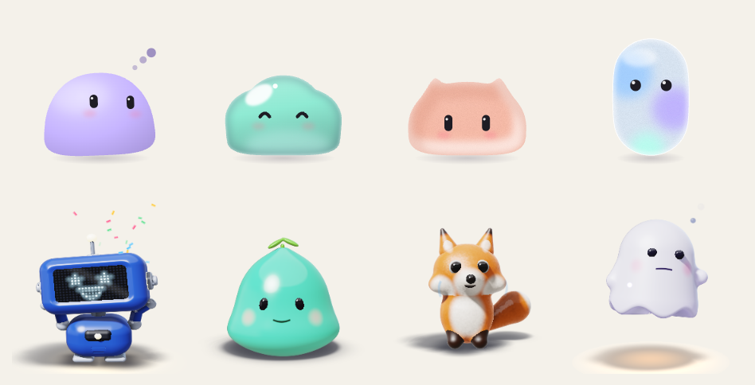

## A mascot drawn by an agent

Codex designed this fox through the MascotForge MCP server. It inspected the first preview, decided the shape looked like a cat, corrected the JSON spec, and exported the result without a provider key.

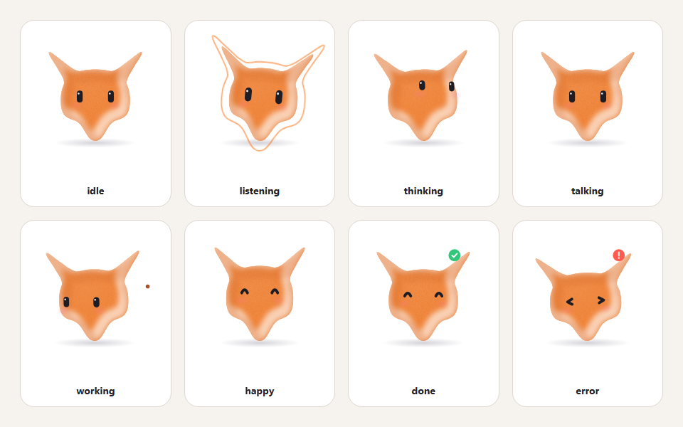

## Base images generated by an agent

Claude Code generated these four plush characters with Z-Image Turbo through its Hugging Face connector. The selected image can continue through the AI video or image-to-3D path.

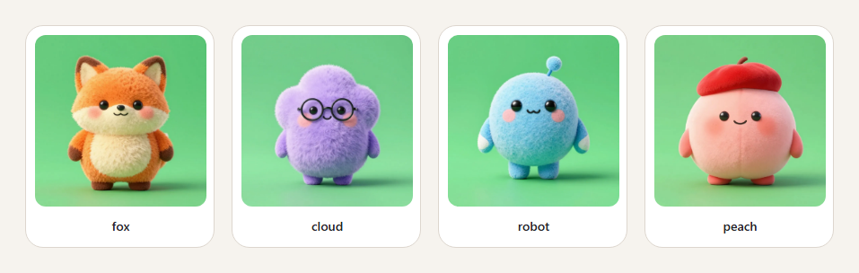

## Image to 3D

The source image appears on the left. A vision model then wrote two Wobnimo interpretations: Visor and Glimmer. The second pass included visual comparison. A result costs about $0.15 to $0.60, depending on the number of correction passes.

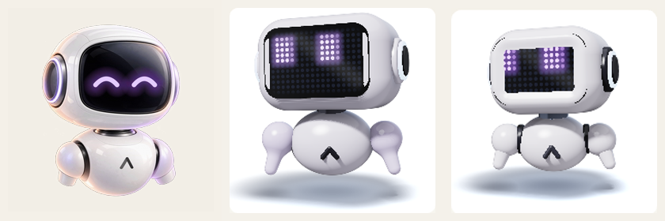

## Ten moods from four angles

The same Glimmer character rendered in ten states and from four viewpoints.

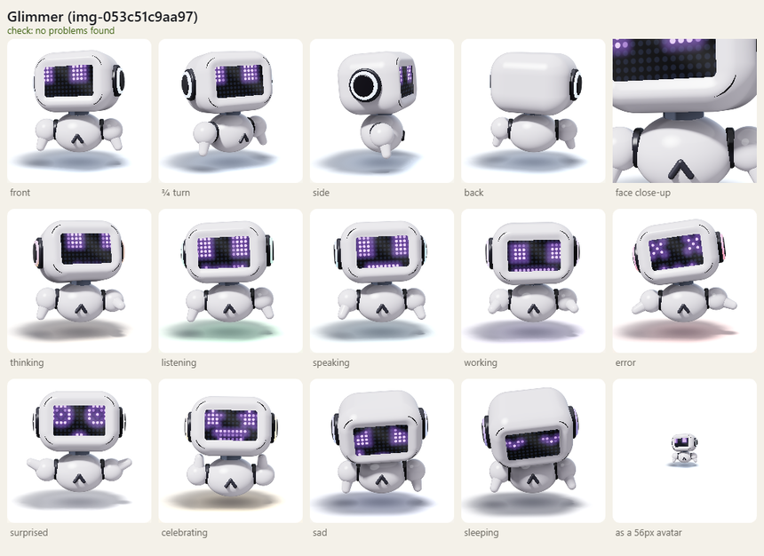

## Custom Blob shapes

An agent can write and validate a custom Blob spec before export.

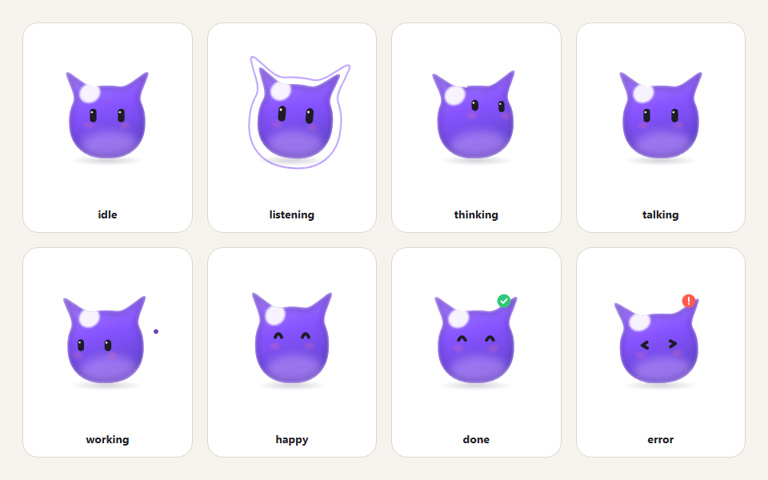

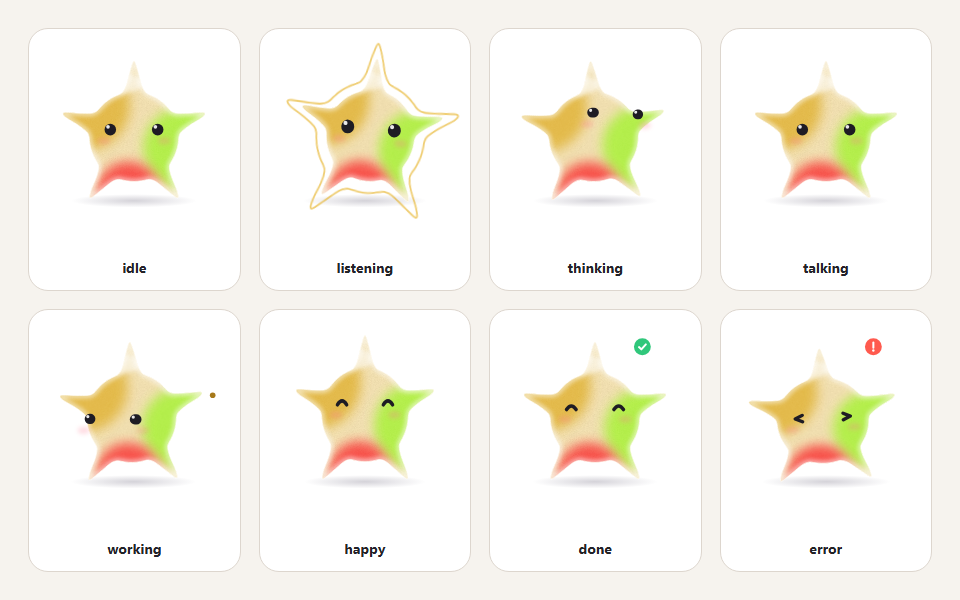

## The studio

### Start

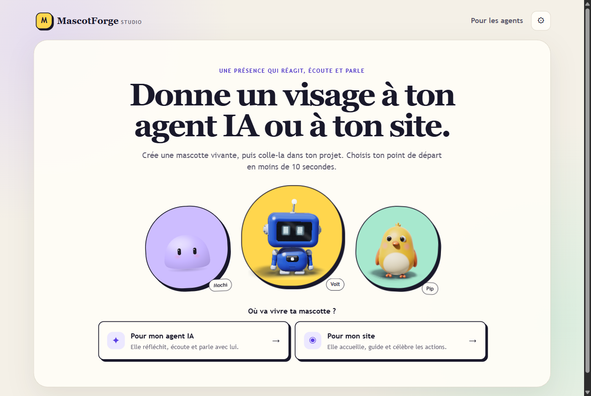

### Choose a path

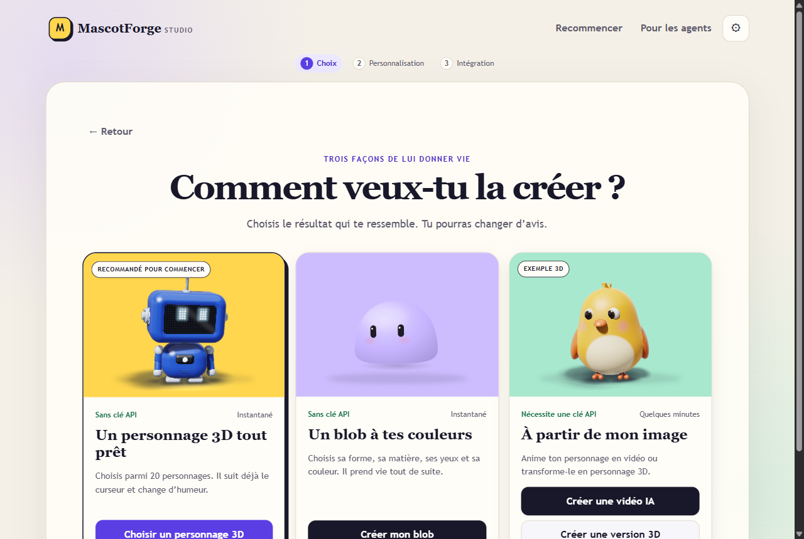

### Integrate the result

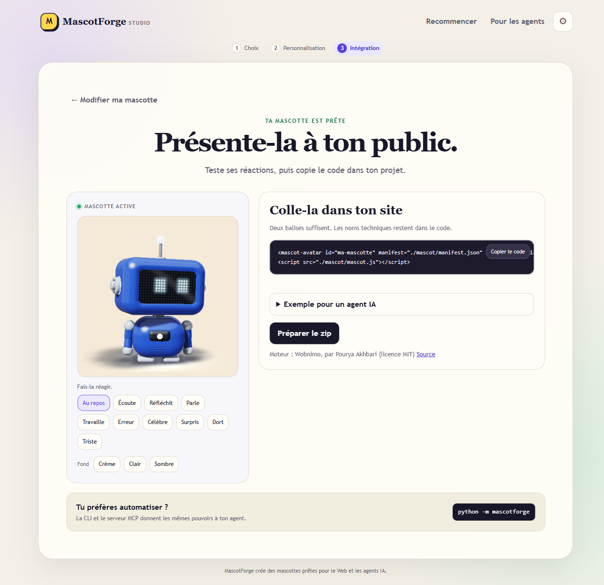

### Configure provider keys

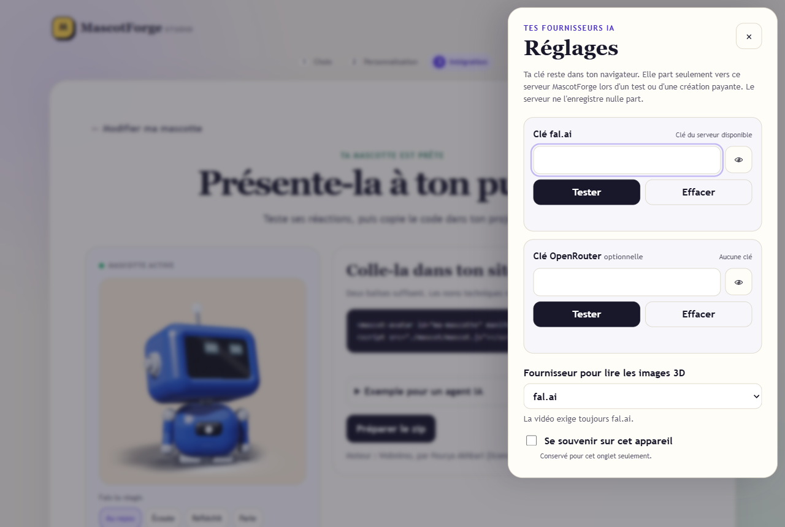

### Connect an agent

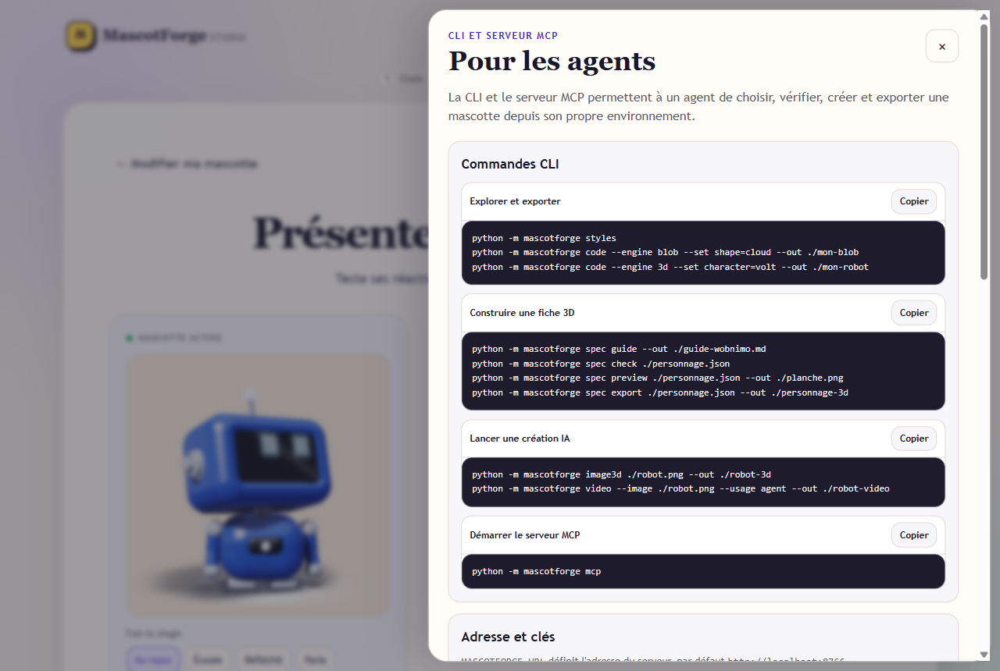

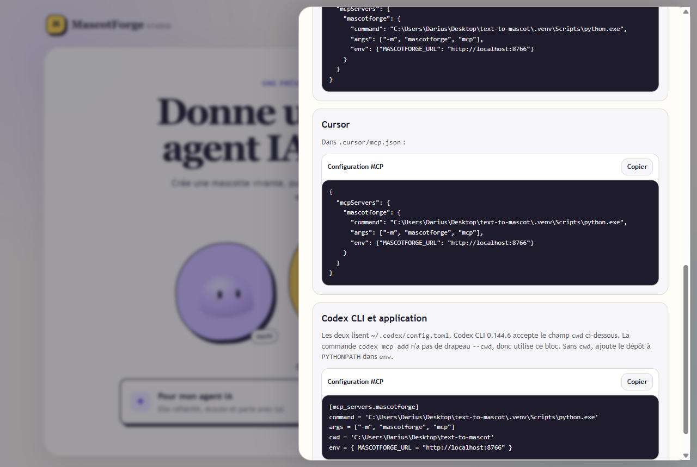

[Create a mascot](https://arivex-ca.github.io/mascotforge/) · [Read the technical reference](technical-reference.md)

